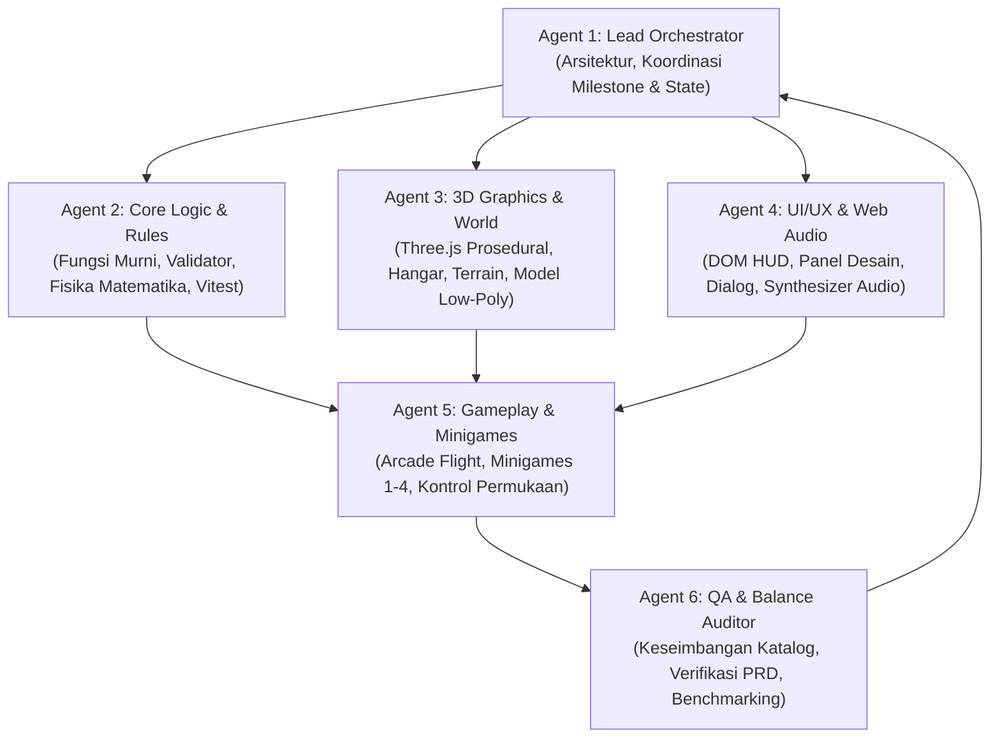
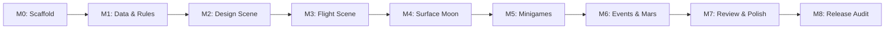
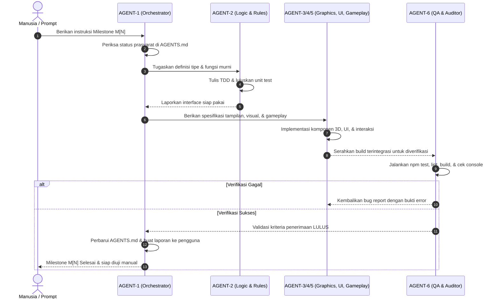

# AGENTS.md — Orkestrasi & Pembagian Tugas AI Agent: ASTRA

> **File Acuan Operasional AI Agent**  
> Proyek: **ASTRA: Space Mission Architect** (Hackathon NASA Space Apps)  
> Sumber Kebenaran Utama: [`PRD.md`](file:///home/ferry/Projects/Nasa/PRD.md) (Jangan pernah mengubah isi PRD.md)  
> Dokumen Pendukung: [`prompt_untuk_ai_agent_bagian_19.md`](file:///home/ferry/Projects/Nasa/prompt_untuk_ai_agent_bagian_19.md), [`VISUAL_POLISH.md`](file:///home/ferry/Projects/Nasa/VISUAL_POLISH.md), `DECISIONS.md`, `README.md`, `CREDITS.md`

---

## 1. Panduan Cepat & Cara Memulai (Quick Start)

Setiap sesi baru AI Agent wajib membaca dokumen ini terlebih dahulu sebelum mengeksekusi kode:

1. **Sumber Kebenaran:** Semua keputusan desain, data katalog, dan rumus mengacu pada [`PRD.md`](file:///home/ferry/Projects/Nasa/PRD.md). Jika terjadi perbedaan interpretasi, aturan urutan prioritas adalah: **Bagian 16 > Bagian 13 & 14 > Bagian 15 > Bagian lainnya**.
2. **Ambiguitas:** Jika ada detail yang ambigu atau kontradiktif, pilih opsi paling sederhana yang memenuhi MVP, dokumentasikan keputusannya di `DECISIONS.md`, lalu lanjutkan pekerjaan. Dilarang mengubah isi `PRD.md`.
3. **Definisi Selesai (Definition of Done):** Suatu milestone HANYA boleh dinyatakan selesai jika:
   - `npm test` lulus 100% tanpa kegagalan.
   - `npm run lint` bersih tanpa error/warning.
   - `npm run build` berhasil menghasilkan bundle `dist/` tanpa error.
   - Aplikasi berjalan stabil pada `npm run dev` dan kriteria penerimaan terverifikasi secara visual/fungsional.

### Perintah Standar Proyek
```bash
npm run dev      # Menjalankan server development Vite lokal
npm run test     # Menjalankan suite pengujian logika dengan Vitest
npm run lint     # Pengecekan standar kode TypeScript dan format
npm run build    # Kompilasi produksi (base: './', target dist/ < 10 MB)
npm run preview  # Menjalankan preview dari build dist/ secara offline
```

---

## 2. Struktur Tim & Pembagian Peran Spesialis AI Agent

Untuk menghasilkan kode yang matang, modular, bebas bug, dan saling terisolasi dengan rapi, tugas dibagi ke dalam 6 peran spesialis:



### Rincian Peran & Tanggung Jawab

| ID Peran | Nama Peran | Lingkup Tanggung Jawab | File & Modul Utama |
| :--- | :--- | :--- | :--- |
| **AGENT-1** | **Lead Orchestrator & System Architect** | - Manajemen urutan milestone (M0–M8)<br>- Scaffold arsitektur Vite + TypeScript strict<br>- Sinkronisasi state global (`store.ts`, `sceneManager.ts`, `save.ts`)<br>- Audit laporan milestone & pencatatan `DECISIONS.md` | `src/main.ts`<br>`src/core/*`<br>`AGENTS.md`<br>`DECISIONS.md` |
| **AGENT-2** | **Core Logic & Pure Rules Engineer** | - Implementasi seluruh rumus di Bagian 14<br>- Validasi skema berkas `data/*.json`<br>- Modul kalkulasi murni (tanpa Three.js & DOM)<br>- Pengujian unit komprehensif di Vitest | `data/*.json`<br>`src/rules/*`<br>`tests/rules/*` |
| **AGENT-3** | **3D Graphics & Procedural World Generator** | - Generator model 3D prosedural low-poly (roket, lander, astronot, props)<br>- Generator terrain Bulan & Mars dengan noise berseed<br>- Pencahayaan & palet warna per destinasi<br>- Optimalisasi draw call (`InstancedMesh`) | `src/gen/*`<br>`src/scenes/flight.ts`<br>`src/scenes/surface.ts` |
| **AGENT-4** | **UI/UX & Web Audio Synthesizer Engineer** | - Komponen DOM + CSS murni (tanpa framework external)<br>- HUD indikator margin 5 variabel + status GO/NO-GO<br>- Panel dialog cerita & briefing NOVA<br>- Efek suara prosedural Web Audio API murni | `src/ui/*`<br>`src/core/audio.ts`<br>`data/dialogs.json` |
| **AGENT-5** | **Gameplay, Flight & Minigames Developer** | - Simulasi fisika arcade penerbangan & pendaratan fixed timestep ($1/60\text{ s}$)<br>- Kontrol karakter astronot orang ketiga di permukaan<br>- Sistem 4 minigame (Foto, Bor, Spektrum, Getaran)<br>- `EventSystem` berseed dan penanganan pilihan event | `src/minigames/*`<br>`src/events/*`<br>`src/scenes/design.ts`<br>`src/scenes/review.ts` |
| **AGENT-6** | **QA, Balance & Release Auditor** | - Tes keseimbangan katalog rakitan (Aturan 10 PRD)<br>- Pengujian edge-case (bahan bakar habis, tabrakan, O2 nol)<br>- Audit performa: $\ge 30\text{ FPS}$ low-end, $<150\text{k}$ segitiga, $<200$ draw calls, dist $<10\text{ MB}$<br>- Pembuatan `README.md` dan `CREDITS.md` | `tests/**/*`<br>`README.md`<br>`CREDITS.md` |

---

## 3. Aturan Emas Pengembangan (Hard Constraints)

Berdasarkan PRD Bagian 0, 13, dan 16, aturan berikut adalah **larangan mutlak**:

1. **Tanpa Aset Eksternal:**
   - Dilarang mengunduh file `.gltf`, `.obj`, `.fbx`, tekstur gambar (`.png`/`.jpg`), font eksternal, atau audio (`.mp3`/`.wav`).
   - Semua mesh dibuat secara prosedural dari geometri primitif Three.js (`BoxGeometry`, `CylinderGeometry`, `SphereGeometry`, dsb.) dengan `flatShading: true` dan pewarnaan vertex.
   - **Pengecualian benda langit (disetujui tim, lihat `DECISIONS.md` nomor 68):** planet, Bulan, dan Matahari berupa bola halus dengan tekstur yang digambar prosedural saat runtime dari noise 3D di kanvas (`src/gen/planetTextures.ts`, `planets.ts`). Tidak boleh ada berkas gambar; hanya tekstur hasil kode. Seluruh model lain dibuat dari primitif Three.js.
   - **Perubahan atas permintaan pemilik proyek (lihat `DECISIONS.md` nomor 83-85):** model kini punya dua tingkat detail (`src/gen/detail.ts`). *Tinggi* (bawaan): segmen 2x, tepi kotak membulat (`RoundedBoxGeometry`), shading mulus, terrain/pulau mulus. *Rendah*: low-poly `flatShading` seperti sebelumnya. Anggaran tetap berlaku di kedua tingkat (<150.000 segitiga dan <200 draw call per scene), dan game turun ke *rendah* otomatis jika perangkat tidak kuat.
   - **Data geografi Bumi (lihat `DECISIONS.md` nomor 99):** garis pantai Natural Earth (domain publik) tertanam sebagai angka kode di `src/gen/earthData.ts` dan dirasterisasi saat runtime; ini data, bukan berkas gambar/model/audio/font.
   - Semua suara disintesis lewat Web Audio API murni (osilator, noise generator, gain envelope).
2. **Kemandirian Jaringan (Offline Ready):**
   - Tidak boleh ada CDN runtime. Semua library (Three.js, Simplex Noise, Vitest) harus berasal dari paket npm yang terbundle di dalam `dist/`.
   - Build akhir harus dapat dijalankan melalui `npm run preview` tanpa koneksi internet.
3. **Pemisahan Logika Murni (Strict Layer Separation):**
   - Folder `src/rules/` dan `src/events/` **HARAM** mengimpor Three.js, CSS, atau API DOM browser. Logika harus murni TypeScript agar dapat diuji secara terisolasi tanpa mock browser.
4. **Deterministik Berbasis Seed:**
   - Dilarang memanggil `Math.random()`. Seluruh keacakan (terrain, event random, variasi minigame) wajib melewati `src/core/rng.ts` berbasis seed dari `MissionConfig`.
   - Simulasi penerbangan dan pendaratan wajib menggunakan timestep tetap ($dt = 1/60\text{ s}$).
5. **Data-Driven (Zero Magic Numbers):**
   - Angka katalog disimpan di `data/*.json` dan divalidasi saat startup.
   - Konstanta mekanik disimpan di `src/core/constants.ts`. Dilarang menulis angka ajaib tersebar di dalam kode logic.
6. **Integritas Identitas & Hak Cipta:**
   - Gunakan nama badan antariksa fiksi dari PRD (*Badan Antariksa Khatulistiwa*). Jangan mencatut logo NASA, merek komersial, atau karakter berhak cipta.
   - Teks antarmuka sepenuhnya menggunakan Bahasa Indonesia.

---

## 4. Pembagian Kerja Per Milestone (M0 s/d M8)

Setiap milestone dikerjakan berurutan. Jangan memulai milestone baru sebelum milestone berjalan memenuhi seluruh kriteria penerimaan dan lulus verifikasi otomatis.



---

### Milestone M0: Scaffold & Foundation
**Fokus:** Menyiapkan fondasi arsitektur, konfigurasi build, core engine loop, dan switching scene.

| Agen Penanggung Jawab | Tugas Spesifik | Target Berkas |
| :--- | :--- | :--- |
| **AGENT-1 (Lead)** | Inisialisasi Vite + TypeScript (strict mode), setup skrip npm, konfigurasi Three.js, buat `SceneManager` dasar dengan 5 scene placeholder (`Briefing`, `Design`, `Flight`, `Surface`, `Review`). | `package.json`<br>`vite.config.ts`<br>`tsconfig.json`<br>`src/main.ts`<br>`src/core/sceneManager.ts` |
| **AGENT-1 & AGENT-2** | Setup modul global: `store.ts` (state reactive sederhana), `input.ts` (keyboard/mouse listeners), `rng.ts` (deterministic PRNG), dan `constants.ts`. | `src/core/store.ts`<br>`src/core/input.ts`<br>`src/core/rng.ts`<br>`src/core/constants.ts` |
| **AGENT-4 (UI)** | Setup canvas utama Three.js dengan layer overlay DOM di atasnya (`styles.css`), serta penanganan resize viewport. | `src/ui/styles.css`<br>`index.html` |
| **AGENT-6 (QA)** | Konfigurasi Vitest, verifikasi bahwa `npm test`, `npm run lint`, dan `npm run build` dapat berjalan tanpa error. | `vitest.config.ts` |

* **Kriteria Penerimaan (Acceptance Criteria):**
  - `npm run dev` menampilkan canvas WebGL 3D dengan warna latar/fog.
  - Tombol keyboard `1` s/d `5` dapat berpindah mulus di antara 5 scene tanpa error di browser console.
  - `npm test`, `npm run lint`, dan `npm run build` lulus 100%.

---

### Milestone M1: Data Katalog & Modul Aturan (Core Rules)
**Fokus:** Pengisian data kanonik, validator skema runtime, implementasi rumus matematika roket/daya/komunikasi, dan unit test.

| Agen Penanggung Jawab | Tugas Spesifik | Target Berkas |
| :--- | :--- | :--- |
| **AGENT-2 (Logic)** | Buat berkas data JSON sesuai spesifikasi kanonik Bagian 14: `rockets.json`, `modules.json`, `instruments.json`, `destinations.json`, `events.json`, `dialogs.json`. | `data/*.json` |
| **AGENT-2 (Logic)** | Buat validator skema untuk seluruh JSON saat dimuat; berikan pesan error eksplisit jika struktur data tidak valid. | `src/rules/schemaValidator.ts` |
| **AGENT-2 (Logic)** | Implementasikan fungsi murni aturan: `mass.ts`, `deltav.ts` (persamaan Tsiolkovsky), `power.ts` (daya siang & malam), `comms.ts`, `budget.ts`, `preflight.ts` (validasi slot & kelayakan Go/No-Go), dan `score.ts`. | `src/rules/*.ts` |
| **AGENT-6 (QA)** | Tulis tes unit di `tests/rules/`: validasi skenario perhitungan misi Bulan (toleransi $\le 0.5\%$), tes keseimbangan katalog (Aturan 10: harus ada kombinasi Go dan opsi termurah tidak otomatis Go). | `tests/rules/*.test.ts` |

* **Kriteria Penerimaan (Acceptance Criteria):**
  - Tes unit perhitungan Bulan dari Bagian 14 lulus persis:
    - Massa kering $m_f = 1048\text{ kg}$
    - Bahan bakar $= 2625\text{ kg}$
    - Massa awal $m_0 = 3673\text{ kg}$
    - Margin massa $= 0.082$ (Kuning)
    - $\Delta v \approx 5534\text{ m/s}$, Margin $\Delta v \approx 0.107$ (Hijau)
    - Total biaya $= 298\text{ MUSD}$
  - Seluruh rumus berjalan murni tanpa dependensi browser/Three.js.
  - `npm test` lulus 100%.

---

### Milestone M2: Scene Desain (Mission Architect Hangar)
**Fokus:** Antarmuka perakitan wahana, visualisasi 3D hanger prosedural, inspeksi 5 indikator margin, dan hand-off konfigurasi misi.

| Agen Penanggung Jawab | Tugas Spesifik | Target Berkas |
| :--- | :--- | :--- |
| **AGENT-3 (Graphics)** | Bangun scene hangar 3D low-poly prosedural: lantai, lampu sorot, perancah pendukung. Buat generator roket dan lander modular yang otomatis menyusun mesh 3D saat bagian modul diubah. | `src/gen/rocket.ts`<br>`src/gen/lander.ts`<br>`src/scenes/design.ts` |
| **AGENT-4 (UI)** | Bangun panel katalog perakitan (pilihan roket, modul, instrumen, slider bahan bakar $0\text{--}100\%$). Tampilkan 5 indikator margin (Budget, Massa, $\Delta v$, Daya, Komunikasi) dengan warna hijau/kuning/merah. | `src/ui/panels.ts`<br>`src/ui/hud.ts` |
| **AGENT-5 (Gameplay)** | Hubungkan pemilihan modul dengan `preflight.ts`. Tampilkan peringatan NOVA jika ada syarat tidak terpenuhi. Kunci tombol *Luncurkan* jika berstatus *No-Go*. Simpan hasil rakitan ke `MissionConfig`. | `src/scenes/design.ts`<br>`src/core/store.ts` |
| **AGENT-6 (QA)** | Verifikasi reaktivitas: setiap perubahan modul seketika memperbarui indikator margin dan mesh 3D tanpa memory leak. | `tests/ui/preflightCheck.test.ts` |

* **Kriteria Penerimaan (Acceptance Criteria):**
  - Mengganti modul roket/lander seketika mengubah tampilan 3D di viewport.
  - Perubahan modul memperbarui 5 indikator margin secara real-time.
  - Tombol *Luncurkan* nonaktif jika terdapat indikator merah atau instrumen misi wajib belum terpasang.
  - Menekan tombol *Luncurkan* saat status *Go* meneruskan `MissionConfig` yang valid ke Scene Penerbangan.

---

### Milestone M3: Scene Penerbangan 3D & Pendaratan Arcade
**Fokus:** Fisika arcade penerbangan, peluncuran roket, manuver orbit, simulasi descent/landing, HUD penerbangan, dan penanganan crash/touchdown.

| Agen Penanggung Jawab | Tugas Spesifik | Target Berkas |
| :--- | :--- | :--- |
| **AGENT-5 (Gameplay)** | Implementasi loop fisika arcade dengan timestep tetap $dt = 1/60\text{ s}$: gravitasi lokal, kontrol throttle vertikal & kemiringan horizontal, konsumsi bahan bakar real-time. | `src/scenes/flight.ts` |
| **AGENT-3 (Graphics)** | Visualisasi peluncuran partikel api/asap prosedural, efek transisi luar angkasa, model lander descending, dan permukaan pendaratan mendekat. | `src/gen/sky.ts`<br>`src/scenes/flight.ts` |
| **AGENT-4 (UI)** | HUD penerbangan: altimeter, speedometer vertikal ($v_y$) & horizontal ($v_x$), indikator sisa bahan bakar, zona pendaratan aman, serta radar horizon. | `src/ui/hud.ts` |
| **AGENT-2 & AGENT-6** | Unit test fisika pendaratan dengan throttle konstan. Validasi aturan touchdown: $v_y \le 2\text{ m/s}$ (Sempurna), $2 < v_y \le 5\text{ m/s}$ (Keras), $5 < v_y \le 12\text{ m/s}$ (Kerusakan), $v_y > 12\text{ m/s}$ (`CRASH_LANDING`), serta kehabisan bahan bakar (`LOW_FUEL`). | `tests/rules/flightPhysics.test.ts` |

* **Kriteria Penerimaan (Acceptance Criteria):**
  - Fisika pendaratan deterministik dan responsif terhadap bobot massa wahana.
  - Touchdown dengan $v_y > 12\text{ m/s}$ memicu status kecelakaan (`CRASH_LANDING`).
  - Bahan bakar habis sebelum mendarat memicu status darurat (`LOW_FUEL`).
  - Touchdown yang sukses mengalihkan state ke Scene Permukaan dengan kondisi wahana yang sesuai.

---

### Milestone M4: Eksplorasi Permukaan Bulan
**Fokus:** Terrain Bulan prosedural berseed, kontrol astronot orang ketiga (Third-Person), hub lander, 4 meter sumber daya, siklus siang-malam, dan uplink data.

| Agen Penanggung Jawab | Tugas Spesifik | Target Berkas |
| :--- | :--- | :--- |
| **AGENT-3 (Graphics)** | Generator terrain Bulan prosedural berbasis noise berseed (kawah, batuan, elevasi rendah). Mesh astronot low-poly dengan animasi prosedural (jalan, lompat, idle). Gunakan `InstancedMesh` untuk batuan sebaran. | `src/gen/terrain.ts`<br>`src/gen/astronaut.ts`<br>`src/gen/props.ts` |
| **AGENT-5 (Gameplay)** | Kontrol pergerakan astronot (WASD + Space untuk lompat dengan gravitasi Bulan $1.62\text{ m/s}^2$). Kamera orang ketiga yang mengikuti karakter. Lander bertindak sebagai hub pengisian daya/oksigen. | `src/scenes/surface.ts` |
| **AGENT-2 (Logic)** | Manajemen 4 resource: Oksigen astronot, Baterai baju, Daya wahana, dan Sinyal uplink ($U$). Aturan siklus waktu (1 jam game = 20 detik; 12 jam siang, 6 jam malam). | `src/rules/power.ts`<br>`src/rules/comms.ts` |
| **AGENT-4 (UI)** | HUD permukaan: 4 bar meter resource, kompas/radar penanda objektif sains, timer siklus siang/malam, dan tombol interaksi uplink. | `src/ui/hud.ts` |
| **AGENT-6 (QA)** | Tes unit: Oksigen habis membuat karakter pingsan dan respawn di hub dengan penalti waktu; panel surya tidak menghasilkan daya di malam hari; formula uplink $U$ terverifikasi. | `tests/rules/surfaceResource.test.ts` |

* **Kriteria Penerimaan (Acceptance Criteria):**
  - Astronot dapat bergerak dan melompat sesuai gravitasi Bulan ($1.62\text{ m/s}^2$).
  - Oksigen berkurang saat di luar hub; mencapai 0 memicu blackout dan pengembalian astronot ke hub.
  - Perubahan siang ke malam menghentikan produksi panel surya dan menguras baterai hub.
  - Rumus uplink $U$ terverifikasi melalui tes unit.

---

### Milestone M5: Sistem Minigame Sains MVP
**Fokus:** Interface standar minigame dan implementasi 4 minigame sains (Foto Panorama, Bor Presisi, Cocokkan Spektrum, Kalibrasi Getaran).

| Agen Penanggung Jawab | Tugas Spesifik | Target Berkas |
| :--- | :--- | :--- |
| **AGENT-5 (Gameplay)** | Buat kontrak antarmuka `Minigame` standar: `start()`, `update()`, `render()`, `finish()`, yang mengembalikan nilai `score01` ($0.0\text{--}1.0$). Hanya dapat diakses jika instrumen terkait terpasang. | `src/minigames/types.ts` |
| **AGENT-5 & AGENT-4** | Implementasi 4 minigame sains interaktif (durasi 20–45 detik):<br>1. **Foto Panorama:** Panning kamera 360°, framing target kawah/formasi dengan garis bidik.<br>2. **Bor Presisi:** Penekanan ritmis menjaga jarum penetrasi di zona hijau stabil.<br>3. **Cocokkan Spektrum:** Menyamakan pita spektrum absorpsi mineral dengan slider panjang gelombang.<br>4. **Kalibrasi Getaran:** Menyelaraskan frekuensi seismik dengan tombol timing. | `src/minigames/photoPanorama.ts`<br>`src/minigames/preciseDrill.ts`<br>`src/minigames/spectrumMatch.ts`<br>`src/minigames/vibrationCalibration.ts` |
| **AGENT-2 & AGENT-6** | Pisahkan fungsi perhitungan skor ke fungsi murni dan buat unit test lengkap untuk setiap formula penilaian minigame. | `tests/rules/minigamesScore.test.ts` |

* **Kriteria Penerimaan (Acceptance Criteria):**
  - Keempat minigame dapat dimainkan menggunakan keyboard dan mouse.
  - Setiap minigame selesai dalam rentang 20–45 detik dan menghasilkan skor normalisasi $0.0\text{--}1.0$.
  - Tes unit fungsi skor minigame lulus 100%.
  - Minigame hanya aktif jika instrumen pendukungnya terpasang pada wahana.

---

### Milestone M6: Sistem Event & Destinasi Mars
**Fokus:** `EventSystem` deterministik berseed, 8 event acak, dan destinasi Mars (terrain merah, atmosfer tipis, badai debu, objektif sains Mars).

| Agen Penanggung Jawab | Tugas Spesifik | Target Berkas |
| :--- | :--- | :--- |
| **AGENT-2 (Logic)** | Implementasi `EventSystem`: pembacaan `events.json`, pemilihan event berbobot dengan seed PRNG, eksekusi efek pilihan (oksigen, daya, waktu, $\Delta v$, sinyal), serta probabilitas kegagalan (`failChance`). | `src/events/eventSystem.ts` |
| **AGENT-3 (Graphics)** | Bangun aset prosedural untuk Mars: terrain merah berpasir, palet langit senja kemerahan/kuning debu, efek partikel badai debu lokal. | `src/gen/terrain.ts`<br>`src/scenes/surface.ts` |
| **AGENT-5 (Gameplay)** | Integrasi gravitasi Mars ($3.71\text{ m/s}^2$), hazard badai debu (mengurangi efisiensi panel surya hingga dibersihkan), serta penanda objektif batuan kuno dan seismometer Mars. | `src/scenes/surface.ts` |
| **AGENT-4 (UI)** | Modal pop-up dialog interaktif untuk pilihan event krisis, menampilkan label konsekuensi dan probabilitas risiko. | `src/ui/dialog.ts` |
| **AGENT-6 (QA)** | Tes unit determinisme event: seed yang sama wajib menghasilkan urutan event dan hasil dadu yang identik; seluruh dampak pilihan event teruji. | `tests/events/eventSystem.test.ts` |

* **Kriteria Penerimaan (Acceptance Criteria):**
  - Seed yang sama menghasilkan urutan event yang sama persis (terbukti lewat tes unit).
  - Pilihan event menerapkan efek perubahan resource dan skor dengan benar.
  - Destinasi Mars dapat dimainkan secara penuh dari fase desain, peluncuran, pendaratan, hingga eksplorasi permukaan.

---

### Milestone M7: Review Misi, Audio Prosedural & Penyimpanan Progres
**Fokus:** Layar Mission Review, kalkulasi bintang & medali, sistem narasi cerita (dialog Beacon), synthesizer Web Audio prosedural, dan `localStorage`.

| Agen Penanggung Jawab | Tugas Spesifik | Target Berkas |
| :--- | :--- | :--- |
| **AGENT-5 & AGENT-4** | Implementasi layar Mission Review: rincian skor sains, perolehan bintang (1–3), kode penyebab kegagalan/keberhasilan, tombol *Perbaiki Desain* (kembali ke hangar dengan konfigurasi sebelumnya), dan tombol *Lanjut*. | `src/scenes/review.ts` |
| **AGENT-4 (Audio)** | Bangun synthesizer Web Audio prosedural murni (`audio.ts`): suara mesin roket, atmosfer angin, klik antarmuka, beep instrumen, nada peringatan alarm, dan jingle review. Sediakan toggle Mute audio. | `src/core/audio.ts` |
| **AGENT-1 & AGENT-5** | Integrasi dialog cerita dari `dialogs.json`: briefing awal, panduan NOVA, dan transmisi misterius Beacon Bulan dan Mars. | `src/ui/dialog.ts` |
| **AGENT-1 (Lead)** | Implementasi sistem penyimpanan progres lokal (`save.ts`) menggunakan `localStorage` yang dibungkus blok `try/catch` (aman untuk mode private/incognito). | `src/core/save.ts` |
| **AGENT-6 (QA)** | Pengujian alur cerita: selesaikan misi Bulan untuk membuka Mars; pastikan progres bintang dan skor tersimpan setelah halaman direfresh. | `tests/core/save.test.ts` |

* **Kriteria Penerimaan (Acceptance Criteria):**
  - Layar Mission Review menampilkan skor transparan dan kode evaluasi yang tepat.
  - Audio prosedural menyala tanpa distorsi dan tombol mute berfungsi seketika.
  - Alur Story Mode dari briefing awal hingga Beacon Mars dapat diselesaikan tanpa error.
  - Progres pemain tersimpan di `localStorage` dan dapat dimuat kembali setelah refresh.

---

### Milestone M8: Audit Rilis, Optimasi Performa & Dokumentasi Final
**Fokus:** Penjaminan mutu akhir, pemenuhan anggaran performa, kebersihan bundle statis, dan kelengkapan berkas dokumentasi publik.

| Agen Penanggung Jawab | Tugas Spesifik | Target Berkas |
| :--- | :--- | :--- |
| **AGENT-6 (Auditor)** | Jalankan audit kepatuhan terhadap 16 bagian PRD. Periksa browser console pada alur penuh untuk memastikan tidak ada pesan error atau warning. | `PRD.md` Audit Check |
| **AGENT-3 & AGENT-6** | Verifikasi anggaran teknis: jumlah segitiga scene $< 150.000$, draw calls $< 200$, performa $\ge 30\text{ FPS}$ pada GPU terintegrasi dan $60\text{ FPS}$ pada laptop standar. | Benchmark Report |
| **AGENT-1 (Lead)** | Audit bundle `dist/`: pastikan total ukuran $< 10\text{ MB}$, dapat dijalankan via `npm run preview` secara offline murni tanpa internet. | Build verification |
| **AGENT-1 & AGENT-6** | Lengkapi dokumentasi: `README.md` (panduan instalasi, kontrol tombol, cara bermain, hasil benchmark), `CREDITS.md` (pernyataan 100% tanpa aset eksternal), dan `DECISIONS.md`. | `README.md`<br>`CREDITS.md`<br>`DECISIONS.md` |

* **Kriteria Penerimaan (Acceptance Criteria):**
  - Folder `dist/` berukuran di bawah $10\text{ MB}$ dan berjalan sempurna via `npm run preview` tanpa koneksi internet.
  - FPS terendah pada scene permukaan Mars $\ge 30\text{ FPS}$.
  - Console browser bersih dari segala uncaught error atau warning.
  - Seluruh rangkaian tes Vitest lulus 100%.

---

## 5. Protokol Kerja Sama & Alur Handoff Antar-Agent



### Aturan Handoff:
1. **Contract-First:** Agent grafis dan UI tidak boleh membuat asumsi bentuk data sendiri. Agent Logic wajib menyelesaikan interface TypeScript dan skema data terlebih dahulu.
2. **TDD Wajib untuk Rumus:** Setiap rumus kalkulasi harus memiliki tes unit di `tests/rules/` sebelum atau bersamaan dengan integrasi ke scene visual.
3. **Rollback & Bug Fix:** Jika terjadi bug, Agent 6 menulis tes yang gagal terlebih dahulu, lalu Agent terkait melakukan perbaikan dengan perubahan sekecil mungkin.

---

## 6. Format Laporan Setiap Milestone

Setiap kali menyelesaikan suatu milestone, AI Agent wajib menyajikan laporan dengan format baku berikut sebelum meminta izin melanjutkan ke milestone berikutnya:

```markdown
### Laporan Milestone: [M0–M8] - [Nama Milestone]

1. **Status Kriteria Penerimaan:**
   - [x] Kriteria 1: [Status LULUS] - Bukti: [Nama tes / output perintah]
   - [x] Kriteria 2: [Status LULUS] - Bukti: [Nama tes / output perintah]
   - [x] Kriteria 3: [Status LULUS] - Bukti: [Hasil build / verifikasi visual]

2. **Hasil Eksekusi Verifikasi Otomatis:**
   - `npm test`: [Jumlah tes lulus, 0 gagal]
   - `npm run lint`: [Bersih tanpa error/warning]
   - `npm run build`: [Berhasil, ukuran dist: XX MB]

3. **Keputusan Baru (DECISIONS.md):**
   - [Catatan keputusan atau interpretasi ambiguitas yang diambil, jika ada]

4. **Risiko & Masalah Terbuka:**
   - [Risiko yang teridentifikasi atau nihil]

5. **Langkah Verifikasi Manual untuk Manusia (3–5 Langkah):**
   1. Jalankan `npm run dev`
   2. Buka browser pada alamat `http://localhost:5173`
   3. Lakukan aksi [X] dan amati respons [Y]
```

---

## 7. Tabel Pelacak Progres Milestone (Live Tracking)

Tabel ini diperbarui oleh Agent Lead setiap kali sebuah milestone selesai divalidasi:

| ID | Milestone | Status | Verifikasi `npm test` | Verifikasi `npm run build` | Verifikasi Manual |
| :---: | :--- | :---: | :---: | :---: | :---: |
| **M0** | Scaffold & SceneManager | ✅ Selesai & Lulus | 9 tes lulus | dist 540 KB | Menunggu uji manual |
| **M1** | Data Kanonik & Aturan Murni | ✅ Selesai & Lulus | 60 tes lulus | dist 540 KB | Menunggu uji manual |
| **M2** | Scene Desain & Indikator Margin | ✅ Selesai & Lulus | lulus (lihat laporan) | dist < 1 MB | Menunggu uji manual |
| **M3** | Scene Penerbangan 3D & Arcade Landing | ✅ Selesai & Lulus | lulus | dist < 1 MB | Menunggu uji manual |
| **M4** | Permukaan Bulan & 4 Meter Resource | ✅ Selesai & Lulus | lulus | dist < 1 MB | Menunggu uji manual |
| **M5** | 4 Minigame Sains MVP | ✅ Selesai & Lulus | lulus | dist < 1 MB | Menunggu uji manual |
| **M6** | Event System Berseed & Destinasi Mars | ✅ Selesai & Lulus | lulus | dist < 1 MB | Menunggu uji manual |
| **M7** | Review Misi, Audio Prosedural & Save | ✅ Selesai & Lulus | lulus | dist < 1 MB | Menunggu uji manual |
| **M8** | Audit Rilis & Verifikasi Performa Final | ✅ Selesai & Lulus (FPS GPU nyata belum diukur) | 266 tes lulus | dist 735 KB | Menunggu uji manual |

*(Status: ⏳ Belum Mulai | 🔄 Sedang Berjalan | ✅ Selesai & Lulus)*

**Tambahan:** Visual Polish (`VISUAL_POLISH.md`) ✅ selesai setelah M8 (`DECISIONS.md` nomor 58–60); perapian pratinjau Desain dan perbaikan landasan peluncuran (61–67); planet bertekstur prosedural dan tata surya di Briefing (68–72); pulau tepi pantai dan lengan umbilikal di peluncuran (73–76); kunci pitch roket sampai lepas landas dan animasi lompat astronot bertahap (77–78); minigame Should Pasang dan Sambungkan serta Bersihkan Panel (79–81); mode Free Design (82); Lunar Cruiser dan detail model tinggi (83–85); perbaikan dek lander dan musik per planet (86–87); perbaikan cincin tahap dan tabrakan objek (88–89); api empat booster Garuda dan arah kemudi Cruiser (90–91); antena di ransel dan suara Cruiser (92–93); pacing tahap peluncuran (94); modul transfer lebih kokoh (95); transisi Bumi ke tujuan bertahap (96); bahan bakar wahana terkuras terlihat (97); Matahari dan lens flare di permukaan (98); Bumi dari geografi nyata, aperture ghosting, lampu sorot malam, dan panel "Bagaimana jika" (99–102); Probe Beacon baru, tekstur daratan, dan skala lander terhadap astronot (103–106); perbaikan probe, airlock, tekstur batu, dan panggung astronot (107); roket jatuh dan meledak bila W dilepas, antena parabola bersama, debu bulat dan jejak sepatu, senter astronot, dan pad Desain sama dengan Penerbangan (108–112); antena Cruiser menapak atap, penghalang tiang lampu dan tangga, satu landasan di Desain (113–115); adegan animasi event (116); layar memuat eager dan panel surya menempel (117–118); Lunar Cruiser juga untuk Mars (119); kap mesin Cruiser baru (120); tekstur alam pulau peluncuran (121); ledakan memecah model menjadi serpihan (122); medan bulat dengan batas jelajah lingkaran (123); bangunan fasilitas peluncuran (124); skala nyata roket, pulau, dan bangunan (125). Audit kepatuhan PRD ada di `AUDIT.md`.
