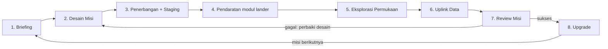

# PRD — ASTRA: Space Mission Architect

Oct 16, 2026 · @Dawa

> Prompt untuk AI agent ada di file terpisah: `PROMPTS.md`.

## 0. Instruksi untuk AI Agent

**Tugasmu:** membangun game web 3D low-poly *ASTRA: Space Mission Architect* dari nol sampai bisa dimainkan di browser, sesuai PRD ini. Target pertama adalah MVP: misi Bulan dan misi Mars, lengkap dari desain sampai review.

**Cara membaca dokumen ini:**

| Bagian | Fungsi | Sifat |
| --- | --- | --- |
| 1-12 | Spesifikasi produk: cerita, gameplay, planet, minigame, simulasi, tampilan | Sumber kebenaran perilaku game |
| 13 | Stack, struktur repo, skema data | Wajib diikuti persis |
| 14 | Data awal dan rumus eksak | Wajib diimplementasikan persis; angka masuk ke berkas data |
| 15 | Scope MVP, milestone, kriteria penerimaan | Urutan kerja yang harus diikuti |
| 16 | Aturan kerja, larangan, risiko | Wajib dipatuhi |
| 17-18 | Konteks submission hackathon dan referensi | Untuk tim manusia; tidak perlu diimplementasikan |

**Urutan prioritas jika ada konflik:** bagian 16 di atas bagian 13 dan 14, lalu bagian 15, lalu bagian lain. Angka di tabel bagian 6-12 adalah nilai awal; nilai kanonik ada di bagian 14.

**Saat ada hal yang ambigu:** pilih opsi paling sederhana yang tetap memenuhi MVP, catat alasannya di `DECISIONS.md`, lalu lanjut. Bertanya ke manusia hanya jika pekerjaan benar-benar terblokir.

**Definisi selesai untuk setiap milestone:** semua kriteria penerimaan di bagian 15 terpenuhi, `npm test` dan `npm run build` lulus tanpa error, dan hasilnya bisa dimainkan lewat `npm run dev`. Jangan menandai milestone selesai sebelum itu.

**Keluaran akhir yang diharapkan:** repo kode lengkap, folder `dist/` statis yang siap di-host, `README.md` (cara menjalankan, kontrol, cara bermain), `CREDITS.md`, dan `DECISIONS.md`.

## 1. Ringkasan Eksekutif

**ASTRA: Space Mission Architect** adalah game 3D low-poly di mana pemain merancang, meluncurkan, dan menjalankan satu misi luar angkasa utuh: dari rapat desain dengan budget terbatas, menerbangkan roket bertahap (*multi-stage*) sendiri, sampai berjalan kaki di permukaan planet untuk menyelesaikan misi sains.

**Tagline:** Rancang misinya. Terbangkan sendiri. Jalani di permukaan.

**Elevator pitch:** Kamu adalah Mission Architect di badan antariksa fiksi. Setiap keputusan teknis (massa, daya, bahan bakar, instrumen, kru) langsung terasa di gameplay: roket yang terlalu berat kehabisan bahan bakar, pelepasan tahap roket (*staging*) yang tepat waktu membuat penerbangan semakin ringan dan lincah, panel surya yang kurang membuat rover mati di malam planet, dan antena yang salah membuat data tidak sampai ke Bumi. Pemain tidak membaca teori trade-off; mereka mengalaminya.

**Yang membuat ASTRA berbeda:**
- **Satu misi, tiga sudut pandang:** ruang desain (strategi), kokpit roket dengan mekanik pelepasan tahap di angkasa (pilot), dan permukaan planet (eksplorasi orang ketiga).
- **Desain menentukan gameplay:** pilihan di fase desain mengubah jumlah tahapan roket, handling penerbangan, durasi oksigen, dan minigame yang tersedia.
- **Setiap planet unik:** misi, minigame, hazard, dan event random berbeda di tiap destinasi.
- **Berbasis data NASA:** gravitasi, atmosfer, suhu, dan durasi hari mengikuti data nyata yang disederhanakan.

**Platform target:** build WebGL yang bisa dibuka juri lewat browser (tanpa instalasi), dengan kontrol keyboard + mouse.

## 2. Latar Belakang & Keselarasan dengan Challenge

Challenge NASA Space Apps meminta game interaktif yang membiarkan peserta merancang, mengelola, dan mensimulasikan misi luar angkasa lengkap sambil membuat keputusan rekayasa dan mengelola sumber daya terbatas. Masalahnya: trade-off misi sulit dirasakan siswa karena jarang ada yang bisa mencoba satu misi penuh dari konsep sampai operasi. ASTRA menjawabnya dengan mengubah setiap trade-off menjadi konsekuensi yang bisa dimainkan.

Tabel berikut memetakan tiap elemen yang disebut challenge ke fitur game:

| Elemen challenge | Fitur di ASTRA | Fase |
| --- | --- | --- |
| Mission objectives | Pilih tujuan sains (mis. cari es air, ambil sampel batuan) dan target skor sains | Desain |
| Spacecraft design | Rakit wahana dari modul: struktur, tangki, mesin, panel surya, baterai | Desain |
| Scientific instruments | Pilih instrumen (spektrometer, bor, kamera, seismometer); tiap instrumen membuka minigame | Desain, Permukaan |
| Launch vehicles | Katalog roket multi-tahap dengan kapasitas muatan, jumlah *stage*, thrust, dan biaya berbeda | Desain, Penerbangan |
| Budgets | Budget misi dalam juta USD fiksi; tiap komponen berbiaya | Desain |
| Power | Anggaran daya: produksi surya vs konsumsi instrumen, siklus siang-malam | Desain, Permukaan |
| Mass | Batas massa peluncuran & pengurangan massa bertahap lewat *stage separation* (*jettison*) | Desain, Penerbangan |
| Communications | Pilih antena dan data rate; ada jeda sinyal dan jendela komunikasi | Desain, Permukaan |
| Orbital constraints | Jendela peluncuran, pelepasan tahap roket, delta-v, orbit parkir, pendaratan | Penerbangan |
| Simulate complete mission | Misi dimainkan langsung: peluncuran, staging, perjalanan, pendaratan, operasi | Semua |
| Evaluate how choices shape success | Layar Mission Review: skor, penyebab sukses atau gagal, dan saran perbaikan | Pasca-misi |

## 3. Target Pemain & Tujuan Edukasi

**Target utama:** siswa SMP–SMA dan mahasiswa tahun awal (usia 13–22) yang suka game tetapi belum mengenal rekayasa misi antariksa.  
**Target kedua:** juri hackathon dan pendidik STEM yang butuh demo singkat dan mudah dipahami.

**Setelah satu sesi (10–15 menit), pemain dapat:**
1. Menjelaskan bahwa massa, bahan bakar, daya, dan budget saling membatasi (trade-off), serta mengapa roket membuang bagian tubuhnya yang kosong secara bertahap di angkasa agar lebih ringan dan lancar dikendalikan.
2. Menyebut mengapa tiap planet butuh desain wahana berbeda (gravitasi, atmosfer, suhu, hari-malam).
3. Memahami peran instrumen sains dan hubungannya dengan tujuan misi.
4. Memahami bahwa komunikasi dan daya adalah kendala nyata di permukaan planet lain.
5. Membaca hasil misi dan menghubungkan kegagalan dengan keputusan desain.

**Prinsip desain:**
- **Belajar lewat bermain:** fakta sains muncul sebagai konsekuensi, bukan layar teks panjang.
- **Gagal dengan aman:** kegagalan memberi penjelasan dan tombol *Perbaiki desain*, bukan hukuman.
- **Akurat tapi disederhanakan:** angka mengikuti data NASA yang dibulatkan; rumus dibuat ramah pemain.
- **Cepat dimengerti juri:** satu misi lengkap bisa dimainkan di bawah 10 menit.

## 4. Cerita & Dunia Game

**Premis:** Tahun 2061, badai Matahari raksasa bernama *Kappa Event* melumpuhkan satelit dan memutus jaringan komunikasi antarplanet. Dalam kekacauan itu, arsip data kehilangan peta navigasi tata surya. Tersisa satu petunjuk: sinyal lemah dari *Beacon* kapsul waktu yang ditinggalkan probe-probe generasi lama di berbagai dunia. Memulihkan semua Beacon berarti membangun kembali jaringan komunikasi tata surya.

Pemain adalah **Arka** (nama bisa diganti), Mission Architect muda di **Badan Antariksa Khatulistiwa**, badan fiksi yang kecil, kekurangan dana, tapi penuh tekad.

**Karakter pendukung:**
- **NOVA:** AI co-pilot di kokpit; memberi telemetri, aba-aba pelepasan tahap roket (*stage separation*), humor ringan, dan penjelasan sains singkat.
- **Dr. Sekar Wulandari:** Mission Director dan mentor; memberi briefing dan menilai hasil misi.
- **Tim Ground Control:** suara radio yang memberi kesan dunia hidup (dengan jeda sinyal sesuai jarak).

**Struktur tiga babak:**
1. **Babak 1, Peluncuran Pertama (Bulan):** Tutorial. Arka belajar merancang, melepas tahapan roket saat terbang, dan berjalan di permukaan. Beacon pertama ditemukan dan memutar pesan rekaman insinyur masa lalu.
2. **Babak 2, Jejak Para Leluhur (Mars, lalu Europa dan Venus):** Tiap dunia membawa tantangan teknis berbeda dan satu Beacon. Pesan-pesannya membentuk cerita tentang generasi insinyur yang menolak menyerah.
3. **Babak 3, Pesan untuk Masa Depan (Titan):** Beacon terakhir memulihkan jaringan. Pemain merekam pesan untuk generasi berikutnya, sehingga misi pemain menjadi bagian dari warisan itu.

**Tone:** hangat, optimis, penuh rasa takjub, dengan humor ringan dari NOVA. Tidak ada musuh manusia; lawan pemain adalah fisika, waktu, dan budget.

**Catatan scope:** untuk MVP hackathon, cerita dimainkan sampai Beacon Mars lalu ditutup dengan cuplikan *Bersambung ke planet berikutnya*.

## 5. Core Gameplay Loop

Satu misi berjalan dalam tiga fase yang dimainkan langsung (desain, penerbangan, eksplorasi) dan diakhiri review yang mengembalikan pemain ke desain.



**Alur 8 Langkah Misi:**
1. **Briefing:** Dr. Sekar memberi tujuan dan batasan →
2. **[FASE INTI] Desain Misi:** Roket, wahana, instrumen, budget →
3. **[FASE INTI] Penerbangan & Staging:** Kemudikan roket; lepas bagian roket satu per satu (*stage separation*), orbit, dan event →
4. **Pendaratan:** Atur kecepatan dan sudut mendarat dengan modul lander akhir →
5. **[FASE INTI] Eksplorasi:** Jalan + minigame + event random →
6. **Uplink Data:** Kirim data sains via antena →
7. **Review Misi:** Skor + analisis sebab-akibat:
   - *Jika gagal:* perbaiki desain (kembali ke langkah 2: Desain Misi).
   - *Jika sukses:* lanjut ke langkah 8.
8. **Upgrade:** Pakai poin sains, buka teknologi → kembali ke langkah 1 (Briefing misi berikutnya).

Hasil review menentukan jalur berikutnya: misi gagal membawa pemain kembali ke Desain Misi dengan petunjuk penyebabnya, misi sukses memberi poin sains untuk upgrade dan membuka planet berikutnya.

**Target durasi satu misi:** briefing 1 menit, desain 3–4 menit, penerbangan 2–3 menit, eksplorasi 4–5 menit, review 1 menit. Total sekitar 10–12 menit, cukup untuk demo juri.

## 6. Fase 1: Mission Design

Pemain merakit misi di hangar 3D: memilih tujuan, roket, modul wahana, dan instrumen, sambil memantau lima indikator yang selalu terlihat (budget, massa, daya, komunikasi, delta-v). Fase ini selesai ketika pemain lolos *Preflight Go/No-Go* dari Dr. Sekar.

**Alur layar desain:**
1. **Pilih tujuan dan objektif sains:** Mis. Mars: cari jejak air purba. Objektif menentukan instrumen yang dibutuhkan.
2. **Pilih roket peluncur:** Menentukan muatan maksimum, jumlah tahapan pelepasan (*stages*), dan biaya.
3. **Rakit wahana:** Seret modul ke blueprint 3D: badan lander, tangki bahan bakar, mesin, panel surya atau baterai, antena. Wahana ini ditempatkan di bagian paling atas roket (di dalam *payload fairing*).
4. **Pasang instrumen sains:** Tiap instrumen punya massa, daya, biaya, dan membuka satu minigame di permukaan.
5. **Preflight check:** Lima indikator berubah merah/kuning/hijau; NOVA memberi peringatan jika ada risiko (mis. daya malam tidak cukup).
6. **Launch:** Pemain berpindah ke kokpit.

**Katalog roket (angka game, disederhanakan):**

| Roket | Muatan maks ke orbit rendah (kg) | Tahapan (*Stages*) | Biaya (juta USD) | Karakter handling awal |
| --- | --- | --- | --- | --- |
| Pandu-1 | 4.000 | 2 Tahap | 80 | Lincah, murah, muatan kecil |
| Rajawali-2 | 12.000 | 3 Tahap | 180 | Seimbang, bertambah lincah tiap lepas tahap |
| Garuda Heavy | 28.000 | 4 Tahap (termasuk *booster*) | 340 | Awalnya berat dan panjang; menjadi lincah setelah tahap awal dilepas |

**Katalog instrumen (angka game):**

| Instrumen | Massa (kg) | Daya (W) | Biaya (juta USD) | Minigame yang dibuka |
| --- | --- | --- | --- | --- |
| Kamera Panorama | 8 | 15 | 15 | Foto Panorama |
| Stasiun Cuaca | 10 | 8 | 20 | Pasang dan Sambungkan |
| Seismometer | 12 | 10 | 25 | Kalibrasi Getaran |
| Spektrometer | 20 | 30 | 35 | Cocokkan Spektrum |
| Bor Sampel | 45 | 60 | 55 | Bor Presisi |
| Radar Penembus Es | 60 | 90 | 80 | Pindai Radar |

**Aturan keputusan yang harus terasa:** instrumen lebih banyak berarti skor sains lebih tinggi tetapi massa, daya, dan biaya naik; roket besar menghabiskan budget sehingga sisa dana untuk wahana menipis; panel surya besar menambah massa tetapi menyelamatkan misi saat malam planet.

## 7. Fase 2: Penerbangan 3D & Sistem Pelepasan Tahap (*Multi-Stage Rocket*)

Pemain mengemudikan sendiri roket dan wahana dari peluncuran sampai pendaratan, dengan fisika arcade yang terasa nyata tetapi mudah dikontrol. Selama di angkasa, roket memiliki tahapan-tahapan pelepasan komponen (*staging*) satu per satu sehingga bentuk roket yang tadinya panjang dan berat berangsur menjadi pendek, ringan, dan semakin lancar dikendalikan.

**Sistem Tahapan Roket (*Multi-Stage Separation*):**
Secara visual dan fisik, roket tersusun secara vertikal dari bawah ke atas dan dilepas secara berurutan di angkasa:
1. **Tahap 1 (*Side Boosters / Lower First Stage*):** Memberi daya dorong awal menembus atmosfer bawah. Saat habis dan dilepas, bagian paling bawah/samping roket terlepas mundur dan terbakar menjauh.
2. **Tahap 2 (*Core / Upper Stage*):** Membawa roket mencapai kecepatan orbit parkir dan menginisiasi dorongan awal antarplanet. Saat dilepas, silinder tengah roket terpisah dan ukuran roket memendek secara signifikan.
3. **Tahap 3 (*Payload Fairing & Transfer Stage*):** Saat keluar dari atmosfer menuju ruang hampa, selubung pelindung hidung (*fairing*) membelah dua dan terlepas, memperlihatkan wahana pendarat (*lander*) di dalamnya. Setelah manuver *transfer burn* selesai, modul pendorong terakhir dilepas sehingga hanya menyisakan unit *lander* yang ringkas dan pendek untuk fase pendaratan.

*Catatan jumlah tahapan mengikuti jenis roket:* `Pandu-1` memiliki 2 tahapan pelepasan sebelum menjadi lander murni, `Rajawali-2` memiliki 3 tahapan, dan `Garuda Heavy` memiliki 4 tahapan (diawali pelepasan *side boosters*). Jumlah penekanan `F` dalam satu misi sama dengan jumlah tahapan roket. Nama dan durasi tiap tahap ada di bagian 14.

**Tahapan penerbangan:**
1. **Peluncuran & *Ascent Staging*:** Tahan thrust, atur sudut *gravity turn* mengikuti garis panduan. Ketika indikator bahan bakar tahap berjalan mencapai 0%, NOVA memberi aba-aba *"Stage Habis — Tekan F untuk Jettison!"*. Pemain menekan `F` untuk melepas bagian bawah roket dan menyalakan mesin tahap berikutnya.
2. **Orbit parkir & Pelepasan *Fairing*:** Stabilkan wahana di orbit Bumi; selubung pelindung (*payload fairing*) membelah dan terlepas otomatis sebagai efek visual (bukan aksi pemain, tombol F hanya untuk melepas tahap roket); rasakan kemudi yang kini jauh lebih ringan karena tubuh roket sudah lebih pendek.
3. **Transfer ke planet tujuan:** Waktu dipercepat; pemain memilih burn di jendela yang ditandai, melepas tahap pendorong saat habis, dan menghindari hazard (debris, semburan Matahari).
4. **Penangkapan orbit:** Melambat tepat waktu agar tertangkap gravitasi planet, lalu melepas adaptor tahap akhir sehingga menyisakan modul *Lander* sepenuhnya.
5. **Pendaratan:** Turun manual menggunakan mesin *Lander* yang pendek dan responsif menuju zona pendaratan dengan indikator kecepatan vertikal, sudut, dan bahan bakar.

**Kontrol (keyboard + mouse):**

| Input | Aksi |
| --- | --- |
| W / S | Thrust naik / kurangi |
| A / D | Roll kiri / kanan |
| Mouse | Pitch dan yaw |
| F | **Lepas tahap roket (*Stage Separation / Jettison*) saat tahap aktif habis** |
| Shift | Boost thruster samping (boros bahan bakar) |
| Spasi | Mode presisi saat pendaratan (kontrol lebih halus) |
| M | Peta navigasi dan jendela burn |

**Aturan fisika game & dampak *Staging*:**
- Percepatan = thrust / massa total, jadi wahana berat lebih lambat merespons.
- **Efek Pelepasan Tahap (*Staging*):** Setiap kali pemain menekan `F` untuk melepas bagian roket yang habis:
  1. Model 3D roket memendek secara nyata (bagian bawah/selubung melayang menjauh dengan efek partikel pemisah).
  2. Massa mati (*dead weight*) terbuang sehingga **respons kemudi (`handling` efektif) meningkat +0,25 per tahap** dan kecepatan rotasi menjadi lebih lincah.
  3. Jika pemain terlambat menekan `F` lebih dari 3 detik setelah tahap habis, roket tetap membawa beban mati sehingga dorongan melambat dan mengurangi skor `flightQuality` (serta menambah `errorFraction` saat burn).
- Angka eksak staging (durasi tahap, batas terlambat, penalti, konstanta) ada di bagian 14; logikanya berupa fungsi murni di `rules/staging.ts`.
- Bahan bakar wahana berkurang saat thrust aktif; habis sebelum mendarat berarti gagal.
- Pendaratan sukses jika kecepatan vertikal di bawah 5 m/s dan kemiringan di bawah 15°; di atas itu wahana rusak dan sebagian instrumen hilang.
- Gravitasi tiap planet berbeda sehingga pola pendaratan di Bulan dan Mars terasa berbeda.

**Event penerbangan acak (contoh):** hujan micrometeoroid, semburan Matahari (daya turun sementara), gangguan mesin atau *staging clamp* macet (minigame singkat tekan urutan tombol untuk memulihkan), dan blackout komunikasi saat melewati belakang planet.

**Kamera dan HUD:** kamera orang ketiga yang otomatis menyesuaikan jarak fokus (*zoom in* halus) seiring roket memendek dari panjang menjadi pendek, dengan opsi kokpit; HUD menampilkan diagram siluet tahapan roket aktif (*Stage* 1/2/3/Lander), bahan bakar per tahap, kecepatan, ketinggian, daya, dan status sinyal ke Bumi.

## 8. Fase 3: Eksplorasi Permukaan

Setelah mendarat, pemain keluar dari wahana dan berjalan dengan karakter orang ketiga di medan low-poly yang luas. Di sini pilihan desain diuji: instrumen yang dibawa menentukan misi yang bisa dikerjakan, dan daya serta oksigen menentukan seberapa jauh pemain boleh pergi.

**Gerakan dan interaksi:**

- **WASD + mouse:** berjalan dan memutar kamera; **Shift** berlari; **Spasi** melompat (tinggi lompatan mengikuti gravitasi planet).
- **E:** berinteraksi (ambil sampel, pasang alat, buka panel).
- **Q:** pemindai portabel yang menandai titik minat dan hazard.
- **Tab:** buka jurnal misi, inventaris sampel, dan peta.

**Hub aman:** wahana pendarat berfungsi sebagai markas. Di dekatnya pemain mengisi ulang oksigen dan baterai suit, serta mengunggah data lewat antena (langkah *Uplink Data*).

**Empat meter yang dikelola pemain:**

| Meter | Berkurang karena | Pulih lewat |
| --- | --- | --- |
| Oksigen suit | Waktu, berlari | Hub wahana |
| Baterai suit | Pemindai, lampu, minigame | Hub wahana |
| Daya wahana | Instrumen aktif, malam planet | Panel surya (siang) |
| Kualitas sinyal | Jarak dari wahana, badai, medan | Mendekat ke antena |

**Struktur satu misi permukaan:**

1. Briefing singkat: objektif utama (wajib) dan objektif bonus (opsional).
2. Berjalan ke titik minat sambil menghindari hazard dan menghadapi event acak.
3. Menjalankan minigame sesuai instrumen yang dibawa.
4. Mengumpulkan sampel dan data, kembali ke hub, lalu *Uplink Data*.

Objektif bonus mendorong risiko: lokasi menarik lebih jauh dari hub sehingga pemain harus menimbang oksigen dan sinyal.

**Siang dan malam:** siklus hari dipercepat; malam mengurangi daya dan visibilitas sehingga pemain perlu merencanakan kapan berangkat dan kapan kembali.

**Kehabisan oksigen bukan akhir permainan.** Jika oksigen mencapai nol, karakter pingsan dan ditarik kembali ke hub dengan penalti waktu dan skor, bukan *game over* mendadak.

## 9. Katalog Planet, Misi, Minigame & Event Random

Lima destinasi memberi variasi: dua masuk MVP (Bulan sebagai tutorial dan Mars sebagai misi utama), tiga lainnya adalah stretch goal. Angka sains berikut dibulatkan dari data NASA dan perlu diverifikasi ulang saat finalisasi aset (lihat bagian Referensi).

**Karakter fisik tiap destinasi:**

| Destinasi | Gravitasi (m/s²) | Atmosfer | Suhu permukaan | Status build |
| --- | --- | --- | --- | --- |
| Bulan | 1,62 | Hampir tidak ada | -173 sampai 127 °C | MVP (tutorial) |
| Mars | 3,71 | Tipis, CO₂, kurang dari 1% tekanan Bumi | Rata-rata sekitar -63 °C | MVP |
| Venus | 8,87 | Sangat padat, sekitar 92 kali Bumi | Sekitar 465 °C | Stretch |
| Europa | 1,31 | Nyaris tidak ada; permukaan es | Sekitar -160 °C | Stretch |
| Titan | 1,35 | Padat nitrogen, sekitar 1,5 kali Bumi | Sekitar -179 °C | Stretch |

**Misi, minigame, dan event unik per destinasi:**

| Destinasi | Misi utama | Minigame | Event random |
| --- | --- | --- | --- |
| Bulan | Ambil sampel regolit di kawah; foto panorama lokasi pendaratan | Foto Panorama, Bor Presisi | Hujan micrometeorit; debu statis menutupi panel surya; semburan surya |
| Mars | Cari jejak air purba di delta kawah kuno; pasang seismometer | Cocokkan Spektrum, Kalibrasi Getaran, Bor Presisi | Badai debu (daya dan visibilitas turun); dust devil melintas; konjungsi Matahari memutus sinyal |
| Venus | Pasang sensor atmosfer sebelum lander kepanasan | Pasang dan Sambungkan versi balapan waktu | Hujan asam; angin super; elektronik overheat |
| Europa | Bor es dan ambil sampel retakan; pindai lautan di bawah es | Pindai Radar, Bor Presisi | Radiasi Jupiter mereset sistem; geyser menyembur; retakan es |
| Titan | Ambil sampel danau metana memakai drone | Drone Sampling (terbang rendah) | Hujan metana; kabut oranye; jeda sinyal sangat panjang |

**Mekanik minigame (tiap minigame berdurasi 20-45 detik):**

| Minigame | Mekanik | Instrumen terkait |
| --- | --- | --- |
| Foto Panorama | Bidik objek menarik dalam bingkai dan tahan kamera stabil agar tidak buram | Kamera Panorama |
| Bor Presisi | Atur tekanan dan kecepatan bor agar tidak panas atau patah sampai kedalaman target | Bor Sampel |
| Cocokkan Spektrum | Putar knob sampai kurva spektrum sesuai pola mineral referensi | Spektrometer |
| Kalibrasi Getaran | Ketuk mengikuti ritme gelombang seismik | Seismometer |
| Pindai Radar | Geser pemindai dan temukan lapisan anomali di bawah es | Radar Penembus Es |
| Pasang dan Sambungkan | Hubungkan kabel sensor ke port yang benar sebelum waktu habis | Stasiun Cuaca |
| Bersihkan Panel | Gosok debu dari panel surya untuk memulihkan daya (event) | Panel surya |

**Aturan event random:** tiap misi permukaan memicu 1-2 event dari kumpulan khusus planet tersebut, dengan bobot peluang. Setiap event menawarkan pilihan risiko-imbalan, misalnya saat badai debu pemain boleh berlindung di wahana (aman, tetapi membuang waktu dan daya) atau melanjutkan (hemat waktu, tetapi oksigen dan sinyal terancam). Event dipilih dengan seed acak agar dapat diulang saat demo.

## 10. Sistem Simulasi & Resource

Lima indikator menjadi tulang punggung game; semuanya dihitung dengan rumus sederhana yang tetap jujur terhadap sains. Aturan umum: **margin 10% atau lebih = hijau, 0-10% = kuning, kurang dari 0% = merah (tidak boleh launch)**.

| Indikator | Dihitung dari | Dampak di gameplay |
| --- | --- | --- |
| Budget | Roket + modul + instrumen + biaya operasi + cadangan | Batas total pilihan; cadangan membantu pulih dari event |
| Massa | Modul + instrumen + bahan bakar | Muatan maks roket; handling di penerbangan |
| Daya | Produksi (panel surya atau RTG) dikurangi konsumsi instrumen, termasuk malam | Instrumen mati jika daya habis; minigame terkunci |
| Komunikasi | Jenis antena, jarak, jeda sinyal | Kualitas dan kecepatan Uplink Data; skor sains |
| Delta-v | Bahan bakar, massa kering, efisiensi mesin | Cukup tidaknya manuver, penangkapan orbit, dan pendaratan |

**Delta-v** dihitung dengan persamaan roket Tsiolkovsky:

```latex
\Delta v = I_{sp}\, g_0 \ln\left(\frac{m_0}{m_f}\right)
```

Dengan *m₀* massa awal (termasuk bahan bakar), *m_f* massa akhir, dan *I_sp* efisiensi mesin. Pemain merasakan bahwa menambah instrumen menaikkan massa kering sehingga delta-v turun, serta memahami prinsip *staging* (membuang tangki/tahap kosong di perjalanan agar massa yang harus didorong tahap berikutnya jauh lebih kecil).

**Daya surya** per panel:

```latex
P = A \cdot \eta \cdot I_{planet} \cdot \cos\theta
```

Dengan luas panel *A*, efisiensi *η*, irradiansi planet *I*, dan sudut Matahari *θ*. Di malam hari *P* = 0 sehingga baterai atau RTG menentukan.

**Konsekuensi per destinasi** (angka dibulatkan; Δv adalah nilai tuning game, bukan perhitungan misi nyata):

| Destinasi | Delta-v dibutuhkan (km/s, game) | Irradiansi Matahari (W/m²) | Jeda sinyal satu arah | Konsekuensi desain |
| --- | --- | --- | --- | --- |
| Bulan | 5,0 | sekitar 1.360 | sekitar 1,3 detik | Panel cukup, tetapi malam sangat panjang sehingga butuh baterai |
| Mars | 6,0 | sekitar 590 | 3-22 menit | Panel lebih besar; debu mengurangi daya |
| Venus | 5,5 | sangat berkurang di permukaan | 2-14 menit | Waktu operasi singkat; fokus pada ketahanan panas |
| Europa | 8,0 | sekitar 50 | 33-53 menit | Panel tidak cukup, RTG diperlukan |
| Titan | 7,5 | sekitar 15 | 70-85 menit | RTG wajib; butuh otonomi karena jeda sinyal panjang |

Jeda sinyal ditampilkan terkompresi di game agar tetap enak dimainkan, tetapi pemain tetap melihat angka aslinya di jurnal misi.

**Antena (pilihan komunikasi):**

- **Antena gain rendah:** ringan dan murah, data rate kecil, tidak perlu diarahkan.
- **Antena gain tinggi:** berat, data rate besar, harus diarahkan ke Bumi.
- **Orbiter relay:** mahal, tetapi memberi sinyal stabil dan jendela komunikasi lebih panjang.

**Risiko dan keandalan:** tiap komponen punya keandalan (0,90-0,99). Cadangan budget dan margin massa menambah peluang pulih dari event, sehingga pemain belajar bahwa margin adalah praktik rekayasa nyata, bukan pemborosan.

## 11. Scoring, Progression & Replayability

Skor akhir misi (0-100) menilai desain dan eksekusi sekaligus, lalu diterjemahkan menjadi 1-3 bintang dan poin sains untuk upgrade.

| Komponen skor | Bobot | Cara dinilai |
| --- | --- | --- |
| Hasil sains | 40% | Objektif utama selesai, kualitas minigame, jumlah data yang berhasil di-uplink |
| Efisiensi desain | 25% | Sisa budget, margin massa dan daya yang sehat, tanpa pemborosan |
| Keselamatan | 20% | Ketepatan pelepasan tahap roket, kondisi pendaratan, oksigen tidak habis, wahana utuh |
| Objektif bonus | 15% | Titik minat jauh, sampel langka, penyelesaian event dengan pilihan cerdas |

**Layar Mission Review** adalah inti pembelajaran. Layar ini menampilkan skor, lalu satu atau dua *penyebab utama* yang ditulis jelas, misalnya "Daya habis di malam hari karena baterai terlalu kecil" atau "Pelepasan tahap roket terlambat sehingga menghabiskan bahan bakar ekstra", disertai tombol *Perbaiki desain* yang membuka layar desain dengan bagian bermasalah ditandai.

**Progression:**

- Poin sains dipakai di pohon upgrade (mesin lebih efisien, panel lebih ringan, antena lebih baik, instrumen baru).
- Menyelesaikan misi membuka destinasi berikutnya dan satu fragmen cerita (Beacon).
- Budget tiap misi naik seiring kemajuan, tetapi misi yang lebih jauh menuntut lebih banyak.

**Mode permainan:**

1. **Story Mode:** alur Bulan, Mars, dan seterusnya dengan cerita dan Beacon.
2. **Free Design:** pilih planet dan instrumen bebas, tanpa cerita; cocok untuk eksperimen siswa.
3. **Daily Challenge** (stretch): satu seed event dan budget tetap; skor dibandingkan di papan peringkat lokal.

**Replayability:** event acak per planet, banyak kombinasi desain yang valid (misi bisa dimenangkan dengan strategi ringan-murah atau berat-aman), objektif bonus, dan pencapaian seperti *Misi Hemat*, *Pendarat Mulus*, dan *Selamat dari Badai*.

## 12. Art Direction, Audio & UI/UX

**Gaya visual:** low-poly berbentuk flat shading dengan palet terbatas, sudut tegas, dan siluet yang mudah dikenali. Gaya ini murah dibuat, ringan di browser, dan konsisten walau aset berasal dari banyak sumber.

**Palet dan mood per destinasi:**

| Destinasi | Palet utama | Mood |
| --- | --- | --- |
| Bulan | Abu perak, biru malam, putih | Sunyi, kontras tajam |
| Mars | Oranye karat, merah muda pucat (langit) | Hangat, luas, sedikit kesepian |
| Venus | Kuning belerang, oranye pekat | Tertekan, panas |
| Europa | Biru es, putih, sentuhan ungu Jupiter | Dingin, misterius |
| Titan | Oranye berkabut, cokelat gelap | Aneh, atmosferik |

**Aset 3D (prosedural):** semua model dibuat dari primitif Three.js (silinder, kerucut, kotak, ikosahedron) dengan warna vertex dan sedikit jitter posisi vertex agar terasa low-poly. Roket, lander, astronot, panel surya, antena, batu, dan kawah masing-masing punya fungsi generator di `src/gen/`.
- **Struktur Modular Roket (`src/gen/rocket.ts`):** Model 3D roket wajib dibangun sebagai hierarki `THREE.Group` terpisah per tahap (*stage group*): segmen booster/tahap bawah, cincin pemisah (*interstage ring*), segmen tahap atas, selubung hidung (*payload fairing* kiri & kanan), dan unit *lander* di bagian puncak. Saat tahap dilepas di angkasa, sub-grup tahap tersebut dilepas dari induk roket, diberi kecepatan mundur + rotasi lambat (*tumbling*), lalu dihapus setelah menjauh, sehingga roket yang dikendalikan pemain tampak berubah dari panjang menjadi pendek secara mulus.
- **Terrain & Karakter:** Terrain dibuat dari grid yang mengikuti pemain, dengan ketinggian dari noise berseed, flat shading, dan warna per ketinggian sesuai palet destinasi. Animasi astronot dibuat prosedural (ayunan anggota badan mengikuti kecepatan), dan tinggi lompatan mengikuti gravitasi destinasi. `CREDITS.md` menyatakan tidak ada aset eksternal.

**Audio (prosedural):** dibuat dengan Web Audio API: dengung ambient berbeda per destinasi (osilator rendah ditambah noise terfilter), suara mesin (noise dengan low-pass yang mengikuti throttle), suara dentuman mekanis singkat + desis gas saat pelepasan tahap roket (*stage separation clunk & retro hiss*), langkah kaki, klik UI, dan statik radio saat sinyal lemah. Dialog NOVA dan Dr. Sekar berupa teks dengan bunyi bip, bukan rekaman suara. Tersedia tombol mute dan pengatur volume.

**UI dan HUD:**
- **Layar desain:** hangar 3D di tengah (menampilkan siluet roket lengkap beserta garis batas tahapan *stage*-nya), katalog di kiri, lima indikator (budget, massa, daya, komunikasi, delta-v) di kanan dengan warna hijau, kuning, merah.
- **Penerbangan:** HUD gaya kokpit minimalis (indikator tahap aktif `STAGE 1/2/3`, prompt tombol `[F] JETTISON STAGE` saat tahap habis, bahan bakar, kecepatan, ketinggian, daya, sinyal).
- **Permukaan:** HUD ringan di sudut layar: empat meter, kompas, dan penanda objektif.
- **Dialog:** NOVA dan Dr. Sekar muncul sebagai panel kecil dengan potret low-poly.
- **Aksesibilitas:** ikon dan bentuk selain warna untuk status, ukuran teks yang bisa diubah, subtitle, dan kontrol yang bisa diatur ulang.

## 13. Spesifikasi Teknis (Wajib Diikuti)

Stack sudah diputuskan; jangan menggantinya. Alasannya: semua bisa dijalankan, diuji, dan dibangun dari terminal tanpa editor visual, dan hasilnya berupa situs statis yang langsung bisa dibuka juri.

| Aspek | Keputusan |
| --- | --- |
| Bahasa | TypeScript (mode `strict`) |
| Build tool | Vite; `base: './'` agar `dist/` bisa di-host di folder mana pun |
| 3D | Three.js dari npm (di-bundle, tanpa CDN saat runtime) |
| Fisika | Kode sendiri (fisika arcade); tanpa library fisika |
| UI dan HUD | Elemen DOM + CSS di atas canvas; tanpa framework UI |
| Audio | Web Audio API, suara dibuat prosedural dengan osilator dan noise |
| Tes | Vitest untuk logika (folder `rules` dan `events`); Playwright smoke test bersifat opsional |
| Penyimpanan | `localStorage` dibungkus try/catch |
| Target browser | Chrome dan Edge desktop terbaru, WebGL2, resolusi 1280x720 ke atas |
| Skrip wajib di `package.json` | `dev`, `build`, `preview`, `test`, `lint` |

**Aturan aset dan rendering:**

- **Tanpa aset eksternal.** Semua model (roket multi-tahap, lander, astronot, batu, kawah, panel, antena) dibuat prosedural dari geometri primitif Three.js; terrain dibuat dari noise berseed; suara dibuat prosedural. Tidak ada berkas model, tekstur, audio, atau font yang diunduh.
- Material: `MeshStandardMaterial` dengan `flatShading: true` dan warna vertex; tanpa tekstur gambar.
- Cahaya: satu directional light dan satu hemisphere light per destinasi; bayangan nonaktif secara default dengan opsi toggle.
- Warna dan suasana per destinasi mengikuti tabel palet di bagian 12 (fog dan warna langit ikut palet).
- Anggaran performa: di bawah 150 ribu segitiga per scene, di bawah 200 draw call (pakai `InstancedMesh` untuk batu dan prop), 60 FPS di laptop menengah dan minimal 30 FPS di grafis terintegrasi; ukuran `dist/` di bawah 10 MB.

**Struktur repo (wajib):**

```text
astra/
├── AGENTS.md
├── DECISIONS.md
├── CREDITS.md
├── README.md
├── package.json
├── vite.config.ts
├── tsconfig.json
├── data/
│   ├── rockets.json
│   ├── modules.json
│   ├── instruments.json
│   ├── destinations.json
│   ├── events.json
│   └── dialogs.json
├── src/
│   ├── main.ts
│   ├── core/
│   │   ├── game.ts
│   │   ├── constants.ts
│   │   ├── rng.ts
│   │   ├── audio.ts
│   │   ├── save.ts
│   │   ├── sceneManager.ts
│   │   ├── input.ts
│   │   └── store.ts
│   ├── rules/
│   │   ├── mass.ts
│   │   ├── deltav.ts
│   │   ├── power.ts
│   │   ├── comms.ts
│   │   ├── budget.ts
│   │   ├── preflight.ts
│   │   ├── staging.ts
│   │   └── score.ts
│   ├── scenes/
│   │   ├── briefing.ts
│   │   ├── design.ts
│   │   ├── flight.ts
│   │   ├── surface.ts
│   │   └── review.ts
│   ├── gen/
│   │   ├── sky.ts
│   │   ├── rocket.ts
│   │   ├── lander.ts
│   │   ├── astronaut.ts
│   │   ├── terrain.ts
│   │   └── props.ts
│   ├── events/
│   │   └── eventSystem.ts
│   ├── minigames/
│   │   ├── types.ts
│   │   ├── photoPanorama.ts
│   │   ├── preciseDrill.ts
│   │   ├── spectrumMatch.ts
│   │   └── vibrationCalibration.ts
│   └── ui/
│       ├── hud.ts
│       ├── panels.ts
│       ├── dialog.ts
│       └── styles.css
└── tests/
    ├── rules/*.test.ts
    └── events/*.test.ts
```

**Skema data (TypeScript).** Berkas JSON di `data/` harus divalidasi terhadap tipe ini saat dimuat; data tidak valid menghentikan game dengan pesan error yang jelas.

```ts
type Id = string;
interface Stage { id: Id; name: string; burnSec: number }
interface Rocket { id: Id; name: string; payloadToLeoKg: number; costMusd: number; handling: number; stages: Stage[] }
interface Module {
  id: Id; name: string; costMusd: number; massKg: number;
  kind: 'lander' | 'tank' | 'engine' | 'solar' | 'battery' | 'rtg' | 'antenna';
  stats: Record<string, number>;
}
interface Instrument { id: Id; name: string; massKg: number; powerW: number; costMusd: number; dataUnits: number; minigameId: Id }
interface Effect { target: 'oxygen' | 'suitBattery' | 'vehiclePower' | 'signal' | 'timeSec' | 'score' | 'deltaVms'; delta: number }
interface EventChoice { label: string; effects: Effect[]; failChance: number; failEffects: Effect[] }
interface GameEvent { id: Id; destinationId: Id | 'any'; phase: 'flight' | 'surface'; weight: number; title: string; description: string; choices: EventChoice[] }
interface Objective { id: Id; title: string; required: boolean; instrumentId?: Id; bonus?: boolean }
interface Destination {
  id: Id; name: string; mvp: boolean; gravity: number; solarIrradianceWm2: number;
  deltaVKmS: number; budgetMusd: number; palette: string[];
  objectives: Objective[]; eventIds: Id[]; minigameIds: Id[];
}
interface MissionConfig { destinationId: Id; rocketId: Id; moduleIds: Id[]; instrumentIds: Id[]; seed: number }
interface MinigameResult { score01: number; durationSec: number }
interface Minigame { id: Id; start(ctx: { rng: () => number; difficulty: number; container: HTMLElement }): void; update(dtSec: number): void; result(): MinigameResult | null }
```

**Prinsip arsitektur:**

- Logika game (folder `rules` dan `events`) adalah fungsi murni tanpa dependensi Three.js atau DOM, sehingga bisa diuji dengan Vitest.
- `MissionConfig` dibuat di scene desain, disimpan di `store`, dan dibaca oleh scene lain; scene tidak saling memanggil langsung.
- Semua acak lewat `rng.ts` (PRNG berseed, mis. mulberry32); dilarang memakai `Math.random()` langsung.

## 14. Data Kanonik & Rumus Eksak

Semua angka di bagian ini disimpan sebagai berkas di `data/` dan dibaca oleh kode; jangan menulis angka ini langsung di dalam logika. Rumus di bagian ini diimplementasikan persis, lengkap dengan tes unit di `tests/rules/`.

**Roket (`rockets.json`):**

| id | Nama | payloadToLeoKg | costMusd | handling (awal) | Jumlah tahap (`stages`) |
| --- | --- | --- | --- | --- | --- |
| pandu_1 | Pandu-1 | 4000 | 80 | 1.2 | 2 |
| rajawali_2 | Rajawali-2 | 12000 | 180 | 1.0 | 3 |
| garuda_heavy | Garuda Heavy | 28000 | 340 | 0.7 | 4 |

**Tahapan tiap roket (`stages` di `rockets.json`).** Tahap terakhir selalu *Fairing + Transfer*; tahap lain dilepas berurutan dari bawah. `burnSec` = lama bar bahan bakar tahap habis pada thrust penuh (nilai tuning awal).

| Roket | Tahap | Nama tahap | burnSec |
| --- | --- | --- | --- |
| Pandu-1 | 1 | Tahap Bawah | 30 |
| Pandu-1 | 2 | Fairing + Transfer | 40 |
| Rajawali-2 | 1 | Tahap Bawah | 25 |
| Rajawali-2 | 2 | Tahap Atas | 30 |
| Rajawali-2 | 3 | Fairing + Transfer | 40 |
| Garuda Heavy | 1 | Side Booster | 20 |
| Garuda Heavy | 2 | Core Bawah | 25 |
| Garuda Heavy | 3 | Tahap Atas | 30 |
| Garuda Heavy | 4 | Fairing + Transfer | 40 |

**Modul wahana (`modules.json`):**

| id | kind | massKg | costMusd | stats |
| --- | --- | --- | --- | --- |
| lander_s | lander | 400 | 40 | instrumentSlots 4, baseLoadW 40 |
| lander_m | lander | 700 | 70 | instrumentSlots 6, baseLoadW 55 |
| tank_s | tank | 80 | 10 | fuelKg 800 |
| tank_m | tank | 160 | 20 | fuelKg 1800 |
| tank_l | tank | 300 | 35 | fuelKg 3500 |
| eng_basic | engine | 120 | 15 | ispS 320, thrustKn 60 |
| eng_eff | engine | 180 | 30 | ispS 450, thrustKn 40 |
| solar_s | solar | 20 | 5 | areaM2 2, efficiency 0.28 |
| solar_m | solar | 35 | 9 | areaM2 4, efficiency 0.28 |
| battery_s | battery | 25 | 8 | capacityWh 400 |
| battery_m | battery | 55 | 16 | capacityWh 1000 |
| rtg | rtg | 45 | 60 | powerW 120 |
| ant_lga | antenna | 5 | 3 | rate 1 |
| ant_hga | antenna | 25 | 18 | rate 8 |
| relay_link | antenna | 0 | 60 | rate 5 (menambah rate antena utama) |

**Aturan perakitan (divalidasi di `preflight.ts`):** tepat 1 lander, tepat 1 engine, 1-2 tank, maksimal 3 panel surya, maksimal 2 baterai, maksimal 1 rtg, tepat 1 antena utama (`ant_lga` atau `ant_hga`) ditambah opsional `relay_link`. Jumlah instrumen tidak boleh melebihi `instrumentSlots`. Pemain boleh mengatur isi bahan bakar 0-100% (default 100%).

**Instrumen (`instruments.json`):** massa, daya, biaya, dan minigame mengikuti tabel di bagian 6. Nilai `dataUnits`: Kamera Panorama 20, Stasiun Cuaca 10, Seismometer 15, Spektrometer 30, Bor Sampel 40, Radar Penembus Es 60.

**Destinasi MVP (`destinations.json`):**

| id | gravity (m/s²) | solarIrradianceWm2 | deltaVKmS (game) | budgetMusd | Objektif wajib | Objektif bonus |
| --- | --- | --- | --- | --- | --- | --- |
| moon | 1.62 | 1361 | 5.0 | 400 | Sampel regolit (Bor Sampel), foto panorama (Kamera Panorama) | Foto kawah jauh (lebih dari 250 m dari wahana) |
| mars | 3.71 | 590 | 6.0 | 650 | Analisis batuan (Spektrometer), pasang seismometer (Seismometer) | Inti bor dari batuan tua (Bor Sampel), foto delta kuno (Kamera Panorama, lebih dari 250 m dari wahana) |

**Rumus perakitan dan indikator:**

- Massa kering `mf` = lander + engine + massa kering semua tank + panel + baterai + rtg + antena + instrumen. Bahan bakar `fuelKg` = jumlah kapasitas tank × isi bahan bakar. Massa awal `m0 = mf + fuelKg`.
- Margin massa = `(payloadToLeoKg - m0) / payloadToLeoKg`.
- Margin budget = `(budgetMusd - totalBiaya) / budgetMusd`, dengan `totalBiaya` = roket + modul + instrumen. Sisa budget berperan sebagai cadangan.
- Margin delta-v = `(dvAvailable - dvRequired) / dvRequired`, dengan `dvRequired = deltaVKmS × 1000` m/s.

```latex
\Delta v_{available} = I_{sp}\, g_0 \ln\left(\frac{m_0}{m_f}\right),\quad g_0 = 9.80665\ \mathrm{m/s^2}
```

- Daya siang `Pday` = jumlah `areaM2 × efficiency × solarIrradianceWm2` semua panel + `powerW` rtg. Beban `Cload` = `baseLoadW` lander + jumlah `powerW` instrumen. Margin daya siang = `(Pday - Cload) / Cload`.
- Satu jam-game = 20 detik nyata; siang = 12 jam-game (240 detik) dan malam = 6 jam-game (120 detik). Energi malam yang dibutuhkan = `Cload × 6` Wh. Margin daya malam = `(kapasitasBaterai + powerRtg × 6 - Cload × 6) / (Cload × 6)`.
- Margin daya = minimum dari margin daya siang dan margin daya malam.
- Margin komunikasi = `(rateTotal × 30 - jumlahDataUnits) / jumlahDataUnits`, dengan `rateTotal` = rate antena utama + rate relay (jika ada) dan `jumlahDataUnits` = jumlah `dataUnits` semua instrumen terpasang.
- **Status indikator:** margin 0,10 atau lebih = hijau; dari 0 sampai kurang dari 0,10 = kuning; di bawah 0 = merah.
- **Go/No-Go:** *Go* hanya jika tidak ada indikator merah, aturan perakitan terpenuhi, dan setiap objektif wajib punya instrumennya terpasang. Jika tidak, tombol Launch nonaktif dan NOVA menampilkan peringatan penyebabnya.

**Contoh hitung untuk tes unit (misi Bulan).** Rakitan: Pandu-1, lander_s, eng_eff, tank_l diisi 75%, solar_m, battery_m, ant_hga, Kamera Panorama, dan Bor Sampel. Kode harus menghasilkan nilai berikut (toleransi 0,5%):

| Besaran | Nilai | Status |
| --- | --- | --- |
| Massa kering `mf` | 1048 kg | - |
| Bahan bakar `fuelKg` | 2625 kg | - |
| Massa awal `m0` | 3673 kg | - |
| Margin massa | 0,082 | Kuning |
| `dvAvailable` | sekitar 5534 m/s | - |
| Margin delta-v | sekitar 0,107 | Hijau |
| Total biaya | 298 juta USD | - |
| Margin budget | 0,255 | Hijau |
| `Pday` | sekitar 1524 W | - |
| `Cload` | 115 W | - |
| Margin daya siang | sekitar 12,3 | Hijau |
| Margin daya malam | sekitar 0,449 | Hijau |
| Margin komunikasi | 3,0 | Hijau |
| Go/No-Go | Go (tidak ada merah, objektif wajib punya instrumen) | - |

**Contoh hitung staging untuk tes unit (`tests/rules/staging.test.ts`):**

| Skenario | Hasil yang harus dihasilkan |
| --- | --- |
| Pandu-1, semua tahap dilepas tepat waktu | `handlingEff` 1,2 → 1,45 → 1,7; `lateStageCount` 0 |
| Rajawali-2, semua tahap dilepas tepat waktu | `handlingEff` 1,0 → 1,25 → 1,5 → 1,75 |
| Garuda Heavy, semua tahap dilepas tepat waktu | `handlingEff` 0,7 → 0,95 → 1,2 → 1,45 → 1,7 |
| F ditekan tepat 3,0 dtk setelah tahap habis | Tidak terlambat (terlambat hanya jika lebih dari 3,0 dtk) |
| Rajawali-2, F tahap 1 ditekan 4 dtk setelah habis | `lateStageCount` 1; `flightQuality` dikurangi 0,10; `errorFraction` ditambah 0,05; skor Keselamatan dikurangi 2; bonus handling tahap 1 tetap berlaku setelah F |
| Tahap habis dan F tidak pernah ditekan | Dilepas otomatis pada 8 dtk; `lateStageCount` bertambah 1 |
| Tahap habis dan belum dilepas | Faktor percepatan 0,8; kembali 1,0 setelah dilepas |

**Aturan penerbangan (`flight.ts`):**

1. **Peluncuran dan orbit parkir** digerakkan roket dan tidak memakai bahan bakar wahana. Keduanya adalah segmen keterampilan (ikuti garis panduan pitch, lalu stabilkan wahana) yang menghasilkan `flightQuality` 0-1 dari rata-rata kesalahan sudut, dikurangi penalti staging (aturan staging di bawah). Pemain melepas tahap dengan tombol F. Jika `flightQuality` di bawah 0,3 misi gagal dengan penyebab `LAUNCH_FAIL`.
2. **Transfer dan penangkapan orbit** adalah satu fase *burn*: pemain menahan thrust sambil menjaga marker prograde. Biaya delta-v = `0,7 × dvRequired × (1 + 0,5 × errorFraction)`, dengan `errorFraction` 0-1 dari rata-rata penyimpangan arah ditambah penalti staging. Jika `dvAvailable` kurang dari biaya, misi gagal dengan penyebab `LOW_FUEL`.
3. **Sisa bahan bakar setelah burn:** `fuelRemaining = m0 × exp(-biaya / (ispS × g0)) - mf`.
4. **Pendaratan:** mulai dari ketinggian 2000 m dengan kecepatan vertikal -60 m/s. Percepatan ke atas = `thrustKn × 1000 × throttle / mCurrent - gravity`, dengan `mCurrent = mf + fuelRemaining`. Laju bahan bakar = `thrustN × throttle / (ispS × g0)` kg per detik. Sensitivitas rotasi = `60 derajat/detik × clamp(sqrt(2000 / mCurrent), 0,5, 1,5)`.
5. **Hasil touchdown** (`vy` = kecepatan vertikal, `tilt` = kemiringan): `vy ≤ 2` dan `tilt ≤ 15` = mulus (faktor 1,0); `vy ≤ 5` dan `tilt ≤ 15` = sukses (faktor 0,7); `vy ≤ 12` atau `tilt > 15` = rusak (faktor 0,3, tiap instrumen hilang dengan peluang 0,4 memakai RNG berseed); `vy > 12` = crash (misi gagal, `CRASH_LANDING`). Bahan bakar habis sebelum touchdown berarti jatuh bebas dengan kecepatan hasil fisika.

**Aturan staging (`rules/staging.ts`, fungsi murni; dipakai oleh `scenes/flight.ts`):**

Tahap roket adalah bagian roket peluncur, bukan wahana: massanya sudah tercakup dalam `payloadToLeoKg` dan tidak masuk rumus massa wahana (`mf`, `m0`) maupun delta-v. Bar bahan bakar tahap (`burnSec`) hanya mekanik waktu dan tidak mengubah `fuelKg` wahana. Biaya delta-v transfer tetap dihitung dengan rumus di aturan penerbangan nomor 2.

1. Tahap 1 sampai n-1 menyala saat peluncuran dan orbit parkir; tahap terakhir (Fairing + Transfer) menyala selama burn transfer. Jumlah penekanan `F` dalam satu misi sama dengan jumlah tahap `n`: satu `F` per tahap, termasuk tahap terakhir setelah penangkapan orbit.
2. Bar tahap aktif turun dari `burnSec` ke 0 selama thrust ditahan (1 detik bar per detik thrust penuh; throttle parsial memperlambat). Saat bar 0, tahap berstatus *habis*: NOVA menampilkan *"Stage Habis - Tekan F untuk Jettison!"* dan mesin tahap berikutnya menyala otomatis, tetapi tahap habis masih menempel.
3. Selama tahap habis masih menempel, percepatan dikali `deadWeightAccelFactor` dan bonus handling tahap itu belum berlaku.
4. Menekan `F` melepas tahap habis: `jettisoned` bertambah 1, bonus handling berlaku, percepatan kembali normal, dan model 3D tahap dilepas (bagian 12).
5. Terlambat = `F` ditekan lebih dari `lateGraceSec` setelah tahap habis; tiap tahap terlambat menambah `lateStageCount` 1. Jika `F` belum ditekan sampai `autoJettisonSec`, tahap dilepas otomatis dan tetap dihitung terlambat (agar game tidak macet).
6. `handlingEff = handling + handlingBonusPerStage × jettisoned`. Dipakai untuk kecepatan rotasi saat peluncuran dan burn: `60 derajat/detik × handlingEff`. Pendaratan memakai rumus sensitivitas rotasi lander di aturan penerbangan nomor 4 (semua tahap sudah lepas).
7. Penalti: `flightQuality = clamp(kualitasSudut - lateFlightQualityPenalty × lateStageCount, 0, 1)` dihitung di akhir orbit parkir; `errorFraction = clamp(penyimpanganArah + lateErrorFractionPenalty × lateStageCount, 0, 1)` dihitung di akhir burn transfer; skor Keselamatan berkurang `lateSafetyScorePenalty × lateStageCount`.
8. Fairing membelah otomatis sebagai efek visual saat ketinggian melewati `fairingSeparationAltitudeKm`; bukan aksi pemain dan tidak dihitung sebagai tahap.

Konstanta staging (disimpan di `src/core/constants.ts`, bukan di logika):

| Konstanta | Nilai | Asal |
| --- | --- | --- |
| handlingBonusPerStage | 0.25 | Ditetapkan di PRD bagian 7 |
| lateGraceSec | 3 | Ditetapkan di PRD bagian 7 |
| autoJettisonSec | 8 | Nilai tuning awal (tambahan) |
| deadWeightAccelFactor | 0.8 | Nilai tuning awal (tambahan) |
| lateFlightQualityPenalty | 0.10 | Nilai tuning awal (tambahan) |
| lateErrorFractionPenalty | 0.05 | Nilai tuning awal (tambahan) |
| lateSafetyScorePenalty | 2 | Nilai tuning awal (tambahan) |
| fairingSeparationAltitudeKm | 100 | Nilai tuning awal (tambahan) |

**Aturan permukaan (`surface.ts`):**

| Parameter | Nilai |
| --- | --- |
| Kecepatan jalan / lari / lompat | 3,0 m/s / 5,5 m/s / 2,0 m/s (tinggi lompat = v² / (2 × gravity)) |
| Oksigen (maks 100) | Berkurang 0,15/dtk diam, 0,30/dtk jalan, 0,60/dtk lari; pulih 5/dtk dalam radius 10 m dari wahana |
| Baterai suit (maks 100) | Berkurang 0,10/dtk; pemindai (Q) memakai 3 per pakai dengan cooldown 3 dtk; minigame memakai 5; pulih 4/dtk dalam radius 10 m dari wahana |
| Daya wahana | Mulai 100% kapasitas baterai; per detik nyata berubah `(P - Cload) / 20` Wh, dengan `P = Pday` saat siang dan `P = powerRtg` saat malam; di 0 instrumen mati dan uplink terblokir |
| Siklus hari | Siang 240 dtk, malam 120 dtk, mulai dari siang; batas waktu permukaan 480 dtk |
| `signalQuality` | `clamp(1 - 0,6 × jarakDariWahanaM / 400, 0,4, 1)` ditambah efek event |
| Oksigen 0 | Karakter pingsan, kembali ke hub, `timeSec` +90, `faintCount` +1 |

**Uplink:** pemain berada dalam radius 10 m dari wahana, menekan interaksi pada antena, dan daya wahana lebih dari 0. Data `D` = jumlah `dataUnits × score01` tiap instrumen yang minigame-nya selesai. Kapasitas `C = rateTotal × 30 × signalQuality`. Faktor uplink `U = min(1, C / D)`; jika `D = 0` maka `U = 0`.

**Skor akhir (`score.ts`, 0-100):**

- Sains (maks 40) = `40 × U × (0,7 × objektifWajibSelesai / objektifWajibTotal + 0,3 × rataRataScore01Minigame)`.
- Efisiensi (maks 25) = `25 × (0,5 × clamp(marginBudget / 0,15, 0, 1) + 0,25 × clamp(marginMassa / 0,10, 0, 1) + 0,25 × clamp(marginDaya / 0,10, 0, 1))`, memakai margin dari rakitan awal.
- Keselamatan (maks 20) = `max(0, 20 × faktorTouchdown - 5 × faintCount - 3 × instrumenHilang - lateSafetyScorePenalty × lateStageCount)`.
- Bonus (maks 15) = `min(15, 5 × objektifBonusSelesai + 2 × eventDitanganiBaik)`; event ditangani baik jika pilihan tidak memicu `failEffects`.
- Bintang: skor 80 atau lebih = 3, 60 atau lebih = 2, 40 atau lebih = 1, di bawah itu atau misi gagal = 0. Poin sains untuk upgrade = `round(skor / 2)`.

**Event awal (`events.json`).** Jumlah event per misi permukaan = 1 ditambah 1 dengan peluang 0,5. Pemilihan berbobot tanpa pengembalian dari event milik destinasi tersebut; waktu pemicu acak seragam antara 45 dan 180 detik setelah mulai permukaan. Tepat 1 event penerbangan dipicu antara burn dan pendaratan dari kumpulan fase `flight`. Satuan efek: `oxygen` dan `suitBattery` dalam unit meter; `vehiclePower` dalam persen kapasitas baterai; `signal` aditif selama 60 detik; `timeSec` menambah waktu terpakai; `score` menambah poin; `deltaVms` mengubah `dvAvailable` dalam m/s.

| id | Destinasi | Fase | Bobot | Pilihan A | Pilihan B |
| --- | --- | --- | --- | --- | --- |
| ev_micrometeor | any | flight | 1 | Putar badan wahana: deltaVms -40 | Terus melaju: failChance 0,4, gagal = deltaVms -90 |
| ev_engine_glitch | any | flight | 1 | Restart urutan: failChance 0,3, gagal = deltaVms -60 | Matikan sementara: deltaVms -20 |
| ev_stage_clamp | any | flight | 1 | Urutan tombol cepat (minigame singkat): failChance 0,3, gagal = deltaVms -50 | Lepas paksa dengan pyro cadangan: deltaVms -30 |
| ev_dust_on_panels | moon | surface | 2 | Bersihkan panel (tahan E 5 dtk): timeSec 10, suitBattery -5 | Abaikan: vehiclePower -20 |
| ev_solar_flare | moon | surface | 1 | Berlindung di wahana: timeSec 30 | Lanjut bekerja: failChance 0,5, gagal = suitBattery -25 dan signal -0,3 |
| ev_micrometeorite_rain | moon | surface | 1 | Berlindung di balik batu: timeSec 20 | Lanjut berjalan: failChance 0,3, gagal = oxygen -20 |
| ev_dust_storm | mars | surface | 2 | Berlindung: timeSec 45, vehiclePower -5 | Lanjut: failChance 0,5, gagal = oxygen -25 dan signal -0,4 |
| ev_dust_devil | mars | surface | 1 | Menghindar ke samping: oxygen -5 | Lindungi alat: failChance 0,3, gagal = vehiclePower -10 dan score -3 |
| ev_solar_conjunction | mars | surface | 1 | Tunggu pulih: timeSec 40 | Tetap uplink: failChance 0,6, gagal = signal -0,5 |

**Kode penyebab di layar Mission Review (`review.ts`):** tiap misi menampilkan satu atau dua kode penyebab dengan pesan berikut.

| Kode | Kondisi | Pesan untuk pemain |
| --- | --- | --- |
| LAUNCH_FAIL | `flightQuality` di bawah 0,3 | Peluncuran meleset dari jalur; latih sudut pitch. |
| LOW_FUEL | Biaya burn melebihi `dvAvailable`, atau bahan bakar habis saat mendarat | Delta-v tidak cukup; kurangi massa atau tambah bahan bakar atau pakai mesin lebih efisien. |
| CRASH_LANDING | `vy` di atas 12 m/s | Wahana menghantam permukaan terlalu keras. |
| DAMAGED_LANDING | Touchdown berstatus rusak | Pendaratan kasar merusak instrumen. |
| NIGHT_POWER | Daya wahana mencapai 0 saat malam | Baterai terlalu kecil untuk malam planet. |
| LOW_COMMS | `U` di bawah 0,5 | Antena terlalu lemah untuk jumlah data. |
| OXYGEN_OUT | `faintCount` lebih dari 0 | Oksigen habis; rencanakan rute dan kembali lebih awal. |
| OBJECTIVE_MISSED | Objektif wajib tidak selesai | Objektif utama belum tuntas. |
| LATE_STAGING | `lateStageCount` lebih dari 0 | Pelepasan tahap roket terlambat sehingga menghabiskan bahan bakar ekstra. |
| OVER_MARGIN_TIGHT | Margin massa atau delta-v di bawah 0,10 saat launch | Margin tipis membuat misi rentan terhadap event. |

## 15. Scope MVP, Milestone & Kriteria Penerimaan

Kerjakan milestone M0 sampai M8 secara berurutan. Milestone berikutnya tidak boleh dimulai sebelum semua kriteria penerimaan milestone sebelumnya lulus. Seluruh teks antarmuka berbahasa Indonesia, dengan semua string disimpan di satu berkas agar mudah diterjemahkan.

| Milestone | Hasil yang harus ada | Kriteria penerimaan (harus bisa diuji) |
| --- | --- | --- |
| M0 Scaffold | Proyek Vite + TypeScript + Three.js, struktur folder bagian 13, `SceneManager`, input, `store`, `rng`, skrip npm, `AGENTS.md` | `npm run dev` menampilkan canvas 3D; tombol 1-5 berpindah antar lima scene kosong; `npm run build` dan `npm test` lulus |
| M1 Data dan aturan | Berkas `data/*.json`, validator skema, modul `rules/` (mass, deltav, power, comms, budget, preflight, staging, score), tes unit | Contoh hitung Bulan di bagian 14 lulus dengan toleransi 0,5%; semua skenario contoh staging di bagian 14 lulus di `staging.test.ts`; data tidak valid menghasilkan error jelas; tidak ada angka katalog yang tertulis di kode |
| M2 Scene Desain | Hangar 3D prosedural, preview roket dan lander yang berubah sesuai pilihan (siluet roket dengan garis batas tahap sesuai `stages`), katalog, lima indikator, peringatan NOVA, tombol Launch | Mengganti modul mengubah indikator seketika; memilih roket mengubah jumlah segmen tahap pada preview; Launch nonaktif jika ada indikator merah atau objektif wajib tanpa instrumen; `MissionConfig` terbaca scene Penerbangan |
| M3 Scene Penerbangan | Peluncuran dengan staging (tombol F), orbit parkir, burn, pendaratan sesuai aturan bagian 14, model roket modular per tahap (`THREE.Group`, bagian 12), HUD tahap, event penerbangan | Hasil touchdown mengikuti tabel bagian 14; bahan bakar habis menghasilkan `LOW_FUEL`; `vy` di atas 12 m/s menghasilkan `CRASH_LANDING`; tes unit fisika pendaratan dengan throttle konstan lulus; massa mengubah respons kontrol; menekan `F` melepas model tahap yang habis dan roket tampak memendek; HUD menampilkan tahap aktif dan prompt `[F] JETTISON STAGE`; tahap terlambat memicu penalti dan `LATE_STAGING` muncul di review |
| M4 Permukaan Bulan | Terrain prosedural, astronot (jalan, lari, lompat sesuai gravitasi), kamera orang ketiga, wahana sebagai hub, empat meter, siklus siang-malam, pemindai, penanda objektif, uplink | Konstanta bagian 14 dipakai; oksigen 0 membuat karakter pingsan dan kembali ke hub; malam menghentikan produksi panel; faktor uplink `U` sesuai rumus (tes unit) |
| M5 Minigame MVP | Antarmuka `Minigame` dan empat minigame (Foto Panorama, Bor Presisi, Cocokkan Spektrum, Kalibrasi Getaran), masing-masing 20-45 detik | Semua bisa dimainkan dengan keyboard dan mouse; masing-masing mengembalikan `score01` 0-1; fungsi penilaian murni punya tes unit; hanya instrumen yang terpasang yang membuka minigame |
| M6 Event dan Mars | `EventSystem` berseed, delapan event awal, destinasi Mars (terrain, palet, objektif) | Seed yang sama menghasilkan urutan event yang sama (tes unit); efek pilihan event diterapkan benar; Mars dapat dimainkan dari desain sampai review |
| M7 Review, cerita, dan poles | Layar Mission Review (skor, bintang, kode penyebab, tombol Perbaiki desain), `dialogs.json` (briefing, NOVA, Beacon Bulan dan Mars), audio prosedural, tutorial singkat, penyimpanan progres | Setiap kode penyebab muncul pada skenario uji; poin sains membuka Mars; Story Mode berjalan dari awal sampai Beacon Mars tanpa error; audio bisa di-mute; progres tersimpan setelah muat ulang |
| M8 Rilis | `README.md`, `CREDITS.md` (menyatakan tidak ada aset eksternal), cek performa, build statis | `dist/` di bawah 10 MB berjalan lewat `npm run preview` tanpa jaringan; minimal 30 FPS di scene permukaan terberat (hasil ukur dicatat di README); tidak ada error console pada alur penuh; semua tes lulus |

**Setelah M8 (urut prioritas):**

1. **Should:** minigame Pasang dan Sambungkan, Pindai Radar, Bersihkan Panel (menggantikan tahan-E pada event debu); pohon upgrade sederhana; mode Free Design; musik berbeda per planet.
2. **Could:** Venus, Europa, Titan; Daily Challenge dengan papan peringkat lokal; Drone Sampling; dukungan gamepad; antarmuka dua bahasa.

**Di luar scope:** multiplayer, akun atau papan peringkat daring, model dan tekstur eksternal, simulasi orbit N-body, dukungan layar sentuh dan mobile.

## 16. Aturan Kerja Agent, Batasan & Risiko

Aturan berikut wajib dipatuhi sepanjang pengerjaan dan menang atas bagian lain jika ada konflik.

1. **Verifikasi sebelum selesai.** Sebelum menandai milestone selesai, jalankan `npm test`, `npm run lint`, dan `npm run build`; semuanya harus lulus.
2. **Data-driven.** Angka katalog dan destinasi hanya berasal dari `data/*.json`; konstanta mekanik penerbangan dan permukaan (bagian 14) ditaruh di `src/core/constants.ts`. Jangan menyebar angka ajaib di kode.
3. **Deterministik.** Semua keacakan lewat `rng.ts` dengan seed yang disimpan di `MissionConfig`; dilarang memakai `Math.random()`. Simulasi fisika memakai timestep tetap 1/60 detik.
4. **Tanpa aset dan jaringan eksternal.** Tidak ada CDN, font web, model, tekstur, atau audio yang diunduh; semua dibuat prosedural. Jangan memakai logo NASA, nama merek, atau karakter berhak cipta; gunakan nama fiksi dari PRD (mis. Badan Antariksa Khatulistiwa).
5. **Pisahkan logika dari tampilan.** Folder `rules` dan `events` tidak boleh mengimpor Three.js atau DOM, agar bisa diuji.
6. **Jangan menambah fitur** di luar PRD. Ide tambahan ditulis di bagian *Ide* pada `DECISIONS.md`, tidak diimplementasikan.
7. **Fakta sains** yang tampil di game hanya yang ada di bagian 9, 10, dan 14. Jangan mengarang fakta baru.
8. **Ambiguitas atau kontradiksi dalam PRD:** pilih opsi paling sederhana, catat di `DECISIONS.md` beserta alasannya, lalu lanjut; jangan mengubah isi PRD.
9. **Kebersihan.** Tidak ada error atau warning di console pada alur permainan penuh; commit kecil dengan pesan jelas; perbarui `README.md` singkat setelah tiap milestone.
10. **Tes keseimbangan wajib** (tambahkan di M1): untuk Bulan dan Mars, uji semua kombinasi rakitan valid dari katalog dan pastikan ada setidaknya satu rakitan berstatus Go, serta rakitan termurah tidak otomatis berstatus Go.

**Risiko dan mitigasi:**

| Risiko | Gejala | Mitigasi |
| --- | --- | --- |
| Fisika pendaratan tidak stabil | Hasil tes tidak konsisten; wahana meledak seketika | Timestep tetap, batasi `dt`, tes unit simulasi dengan throttle konstan |
| Performa WebGL rendah | Di bawah 30 FPS di scene permukaan | `InstancedMesh`, batas segitiga, terrain per chunk, bayangan nonaktif |
| Scope creep | Ada fitur di luar milestone berjalan | Aturan 6 dan kriteria penerimaan per milestone |
| Angka tidak seimbang | Misi mustahil atau semua rakitan lolos | Tes keseimbangan (aturan 10); ubah angka di `data/`, bukan di logika |
| Perubahan API library | Build gagal setelah instal ulang | Kunci versi lewat `package-lock.json` dan `package.json` |
| Minigame tidak adil | Skor selalu 0 atau selalu 1 | Parameter `difficulty` dan tes unit fungsi penilaian |

## 17. Metrik Sukses, Demo & Kriteria Penilaian (untuk tim manusia)

ASTRA berhasil jika juri bisa memainkan satu misi lengkap dalam sekitar 10 menit dan memahami trade-off rekayasa tanpa penjelasan lisan. Kriteria penilaian di bawah mengikuti [Judging & Awards Guide 2024](https://spaceappschallenge.org/resources/judging-awards-guide); cek ulang panduan edisi 2026 karena ketentuan dapat berubah.

**Metrik sukses (target tim):**

| Metrik | Target | Cara ukur |
| --- | --- | --- |
| Pemain baru menamatkan misi Bulan | 4 dari 5 penguji | Playtest tanpa bantuan |
| Durasi satu misi | 10-12 menit | Stopwatch saat playtest |
| Pemain dapat menjelaskan satu trade-off setelah bermain | 4 dari 5 penguji | Pertanyaan singkat setelah sesi |
| Frame rate di laptop menengah | Minimal 30 FPS | Profiler bawaan engine |
| Bug penghalang di build final | 0 | Daftar tes di dua perangkat |

**Pemetaan ke kriteria juri:**

| Kriteria | Bukti di ASTRA |
| --- | --- |
| Influence | Membuat desain misi antariksa mudah dipahami siswa tanpa latar teknik; mode Free Design dapat dipakai di kelas |
| Creativity | Menggabungkan desain misi, kemudi roket, dan eksplorasi permukaan dengan event dan minigame unik per planet |
| Validity | Persamaan roket, irradiansi, gravitasi, dan jeda sinyal berdasarkan data NASA; penyederhanaan dijelaskan di jurnal game |
| Relevance | Setiap elemen challenge terpetakan ke fitur (tabel di bagian 2) dan misi lengkap dari konsep sampai operasi |
| Presentation | Video demo bercerita: Kappa Event, Beacon, lalu misi pemain |

**Kategori penghargaan global yang relevan untuk ditarget:** Best Mission Concept, Best Use of Science, Best Storytelling, dan Art & Technology.

**Alur video demo (sesuaikan dengan batas durasi resmi):**

1. Hook cerita: badai Matahari memutus jaringan, Beacon harus dipulihkan.
2. Desain misi: memilih roket dan instrumen, indikator berubah warna.
3. Penerbangan: peluncuran dengan pelepasan tahap roket (tombol F) dan pendaratan di Mars.
4. Permukaan: berjalan, event badai debu, satu minigame.
5. Review misi: skor, penyebab sebab-akibat, dan dampak edukasi.

**Checklist submission (dari panduan 2024; verifikasi ulang untuk 2026):**

- [ ] Halaman proyek berbahasa Inggris; video berbahasa lain wajib berteks Inggris
- [ ] Semua sumber eksternal (kode, teks, gambar, audio, termasuk yang open source) tercantum di kolom References
- [ ] Tidak ada musik atau gambar berhak cipta tanpa izin
- [ ] Anggota tim maksimal 6 orang dan semuanya terdaftar di halaman tim
- [ ] Tautan demo dapat dibuka tanpa login
- [ ] Proyek dikirim sebelum tenggat lokal acara

## 18. Referensi & Status Verifikasi Data

Panduan Space Apps menekankan penggunaan data NASA dan pencantuman semua sumber eksternal di kolom References, jadi tim perlu menampilkan data NASA secara eksplisit di game (mis. kartu fakta di jurnal misi) dan mencatat setiap sumber.

**Sumber yang sudah dibuka untuk PRD ini:**

| Sumber | Dipakai untuk |
| --- | --- |
| [NASA Planetary Fact Sheet](https://nssdc.gsfc.nasa.gov/planetary/factsheet/index.html) | Gravitasi, tekanan permukaan, dan panjang hari Bulan, Mars, dan Venus |
| [NASA Space Apps Judging & Awards Guide (2024)](https://spaceappschallenge.org/resources/judging-awards-guide) | Kriteria penilaian, syarat submission, kategori penghargaan |

**Status angka di dokumen ini:**

| Angka | Status |
| --- | --- |
| Gravitasi Bulan (1,62), Mars (3,71), Venus (8,87); tekanan Venus sekitar 92 bar; tekanan Mars kurang dari 1% Bumi | Sesuai Planetary Fact Sheet |
| Gravitasi, suhu, dan atmosfer Europa dan Titan; suhu semua destinasi; irradiansi Matahari; jeda sinyal | Perkiraan dibulatkan dari pengetahuan umum; verifikasi ke halaman NASA masing-masing sebelum dipajang di game |
| Delta-v, massa, daya, dan biaya komponen; bobot skor | Nilai tuning game, bukan data NASA |

**Sumber tambahan yang sebaiknya dibuka tim:** halaman NASA Solar System Exploration untuk Europa dan Titan, fact sheet satelit Jupiter dan Saturnus di NSSDC, NASA Eyes on the Solar System untuk referensi visual, dan koleksi model 3D NASA untuk inspirasi bentuk wahana (periksa lisensi sebelum dipakai).
